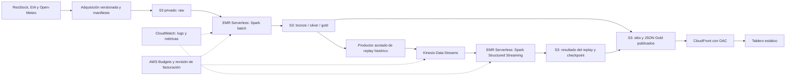

# Arquitectura AWS por etapas

**Estado:** diseño técnico por etapas para el demostrador académico. El 18 de noviembre de 2026 se creó un bucket S3 dedicado y privado en el Learner Lab y se cargó la demo como HTML autónomo; una URL prefirmada temporal permitió verificar la lectura. EMR Serverless negó permisos; Kinesis no se creó y CloudFront no está desplegado.

**Aplicabilidad:** las secciones 2–7 describen la arquitectura objetivo. Para la sesión temporal AWS Academy Learner Lab, prevalecen las restricciones y decisiones de la sección 8. El proyecto continuará sin esperar confirmación externa: se ejecutan los pasos disponibles con bajo consumo y se usan alternativas locales cuando un permiso falte.

## 1. Qué pide el curso y qué compromete la propuesta

`Proyecto-Final.pdf` confirma equipos de cuatro, entrega de código, base de datos y documentación en Google Classroom, y la prohibición de plagio. El documento asigna 50 puntos al proyecto, pero no contiene una matriz técnica con criterios y ponderaciones. La plantilla `Big Data Project Proposal Template.pdf` orienta el formato de la propuesta; sus ejemplos no son requisitos adicionales del profesor.

La propuesta V2 aceptada por el profesor compromete el uso de **Amazon S3**, **Amazon Kinesis Data Streams**, **Apache Spark en Amazon EMR** y un tablero interactivo. También plantea análisis de consumo, detección de anomalías, estimaciones y reproducción progresiva de históricos identificada como simulación. Por ello este diseño conserva esos componentes, pero acota su ejecución a una demostración medible. No supone que los 10,000 perfiles o los 350.4 millones de intervalos ya estén procesados.

## 2. Arquitectura objetivo

### Componentes y límites

| Componente | Diseño propuesto | Límite del demostrador |
|---|---|---|
| S3 | Un bucket dedicado al proyecto, privado, con prefijos `raw/`, `bronze/`, `silver/`, `gold/`, `checkpoints/` y `site/`. Manifiestos con fuente, fecha, hash, esquema y cambios. | Subir solo una muestra seleccionada y datos derivados autorizados. Archivos de entrada inmutables con nombres/versiones que incluyan su hash; no sobrescribir silenciosamente. |
| Spark batch en EMR Serverless | Un job de corta duración lee la muestra desde S3, valida el contrato y produce Parquet Gold/JSON para el tablero. Mismo código se desarrolla primero en local. | Configurar máximo de trabajadores, vCPU, memoria y almacenamiento temporal. Una ejecución pequeña, medición, parada y revisión antes de ampliar. |
| Replay con Kinesis | Productor de prueba lee un segmento histórico ya validado y envía eventos con `replay_id`, `event_time` original, `ingested_at_utc`, `sequence`, fuente y `is_replay=true`. | Límite de eventos y duración configurables; comenzar con una prueba pequeña. El evento de fin del lote debe permitir detener el consumidor Spark; no dejar un stream infinito activo. |
| Spark Structured Streaming | Job EMR Serverless consume Kinesis, aplica el esquema y controles, y escribe resultados idempotentes a S3 con checkpoint específico del `replay_id`. | Una reproducción acotada; cancelar/parar tras recibir el marcador de fin y verificar el resultado antes de limpiar el checkpoint. |
| Tablero | Conservar la web estática existente y sustituir datos embebidos por un `manifest.json` y JSON Gold publicados. CloudFront entrega página y resultados. | Publicar exclusivamente un prefijo `site/` y resultados Gold revisados; nunca exponer `raw/`, `bronze/`, `silver/` ni checkpoints. |
| Observabilidad | CloudWatch Logs para jobs, métricas de filas leídas/escritas, rechazadas, eventos de Kinesis y duración. Etiquetas `project`, `environment`, `owner` y `expires_at` donde el servicio las soporte. | Retención corta explícita para logs de prueba; registrar estimación y costo observado por ejecución. |

## 3. Seguridad y publicación

- Mantener **S3 Block Public Access** habilitado. Para la página pública, usar CloudFront con Origin Access Control (OAC), un origen S3 REST (no endpoint de website estático) y política del bucket limitada a la distribución y a `site/*` y al prefijo Gold aprobado. AWS recomienda OAC para servir una web desde S3 sin hacer público el bucket y conservar HTTPS. [Guía AWS de control de acceso S3](https://docs.aws.amazon.com/AmazonS3/latest/userguide/access-management.html) · [Guía de OAC de CloudFront](https://docs.aws.amazon.com/AmazonCloudFront/latest/DeveloperGuide/private-content-restricting-access-to-s3.html)
- Cifrado S3 administrado por AWS, transporte HTTPS, bucket dedicado y roles separados **si la cuenta lo permite**: productor con permiso de escritura solo en el stream, rol Spark con lectura de entradas/escritura de salida, y CloudFront con lectura solo de contenido público aprobado. En Learner Lab no crear ni modificar roles; verificar el alcance del rol entregado por el curso.
- En una cuenta propia, proteger el usuario raíz con MFA y no crear llaves de acceso raíz. Estas tareas no aplican al usuario de laboratorio. No guardar credenciales, archivos `.env`, tokens ni claves AWS en Git, datos o capturas.
- En una cuenta propia, su titular administrará la facturación y dará a cada integrante acceso individual con el mínimo privilegio. En Learner Lab, se usa la identidad temporal del curso y el administrador controla permisos y ciclo de vida. Antes de cargar datos, seguir [`decision-publicacion-datos.md`](decision-publicacion-datos.md) y respetar atribuciones/licencias.
- La aplicación no necesita backend para este alcance. No añadir API Gateway, Lambda, base de datos administrada, QuickSight o WAF sin una necesidad demostrada y costo revisado.

## 4. Selección de región y compatibilidad

La comparación de regiones que sigue aplica a una cuenta AWS de despliegue. La consola del Learner Lab observada el 18 de noviembre de 2026 usa `us-east-1`; esto no implica que esa región sea elegible para producción ni que los servicios estén autorizados en el laboratorio.

No fijar la región hasta comparar disponibilidad, cuota y estimación en AWS Pricing Calculator. `mx-central-1` es candidata por cercanía al equipo: la documentación vigente lista EMR Serverless en esa región y exige EMR 7.10.0 o posterior. El conector de Kinesis para Spark se incluye en EMR Serverless 7.1.0 o posterior; para consumir Kinesis se requiere configurar acceso VPC y conectividad al stream. [Regiones y releases mínimos de EMR Serverless](https://docs.aws.amazon.com/emr/latest/EMR-Serverless-UserGuide/endpoints-quotas.html) · [Conector Kinesis de EMR Serverless](https://docs.aws.amazon.com/emr/latest/EMR-Serverless-UserGuide/jobs-spark-streaming-connectors.html)

Comparar `mx-central-1` con `us-east-1` usando el mismo escenario. En particular, calcular endpoints VPC, solicitudes/datos S3, Kinesis, EMR, CloudWatch, CloudFront y transferencia. La entrega directa de Kinesis a S3 no está disponible en `mx-central-1` según la [tabla regional de Kinesis Data Streams](https://aws.amazon.com/kinesis/data-streams/pricing/); por eso el flujo propuesto usa Spark como consumidor y escritor S3. La documentación también señala que los jobs EMR Serverless de streaming son de larga duración y no admiten un timeout de ejecución; implementar un marcador de fin y una detención verificada para el replay finito. [Jobs de streaming de EMR Serverless](https://docs.aws.amazon.com/emr/latest/EMR-Serverless-UserGuide/jobs-streaming.html) La tabla regional y disponibilidad deben revisarse antes de elegir la región de despliegue.

## 5. Control de costo y reglas operativas

Para una cuenta AWS de despliegue normal, fijar y autorizar un máximo numérico antes de crear servicios, y documentar una estimación con fecha, región, duración, bytes, solicitudes y eventos. El trabajo actual continúa en Learner Lab bajo la meta interna conservadora que se describe abajo; no se espera confirmación externa para cada paso. Usar [AWS Pricing Calculator](https://calculator.aws/) para:

En Learner Lab, comprobar desde la consola qué operaciones están disponibles y avanzar con pruebas pequeñas. Se usa una meta interna de prudencia de USD 5 de consumo adicional estimado u observado para el siguiente bloque, sin tratarla como tope duro. AWS Budgets se intentará solo si aparece habilitado; si no, registrar la limitación y vigilar el medidor del curso.

| Servicio | Variables que se deben estimar |
|---|---|
| S3 | GB-mes por prefijo/clase, PUT/GET/LIST, tamaño/particiones, salidas y transferencias. |
| EMR Serverless | vCPU-segundos, memoria GB-segundo, almacenamiento temporal y duración de cada job; incluir el minuto mínimo de cobro y el tiempo hasta detener trabajadores. |
| Kinesis Data Streams | Modo provisionado u on-demand, shards/horas o datos de entrada/salida, retención y duración del stream. Kinesis Data Streams no está actualmente en Free Tier. |
| VPC | Endpoints necesarios por zona, tráfico; comparar con cualquier alternativa de NAT antes de crearla. |
| CloudWatch | Volumen y retención de logs, métricas y alarmas. |
| CloudFront | Solicitudes y transferencia saliente estimadas para la exposición. |

El costo de EMR Serverless depende de vCPU, memoria y almacenamiento consumidos por los workers; se factura desde que están listos, por segundo con mínimo de un minuto, además de los servicios asociados. [Precios oficiales de EMR](https://aws.amazon.com/emr/pricing/) Kinesis factura según modo/capacidad y uso; no se asumirá que una prueba pequeña es gratuita. [Precios de Kinesis Data Streams](https://aws.amazon.com/kinesis/data-streams/pricing/)

En una cuenta de despliegue, configurar una alarma de AWS Budgets con umbrales de aviso acordados (por ejemplo, 50/80/100%). En Learner Lab, intentarlo solo si aparece habilitado; si no, registrar el límite y revisar el medidor del curso antes y después de cada bloque. Una alarma **no es un tope duro**: la información de costos puede tener retraso y una notificación puede llegar después de superar el umbral. Complementar las alarmas con máximos del job EMR, duración corta, sin capacidad preinicializada, stream creado solo para la prueba, límite de eventos y verificación manual de terminación/borrado al finalizar. [Retraso y funcionamiento de Budgets](https://docs.aws.amazon.com/cost-management/latest/userguide/budgets-managing-costs.html) · [Acciones de Budgets](https://docs.aws.amazon.com/cost-management/latest/userguide/budgets-controls.html)

En una cuenta AWS de despliegue, dejar anotados titular, monto máximo, estimación, notificaciones y responsable de limpieza. En Learner Lab, usar el bucket dedicado ya creado, revisar el medidor y seguir la meta interna de prudencia; si falta permiso para un servicio, continuar con su alternativa local y registrar la desviación.

## 6. Etapas de implementación y criterios de salida

| Etapa | Trabajo | Evidencia para pasar |
|---|---|---|
| 0. Congelar contratos localmente | Confirmar IDs/campos/unidades/huso de las muestras; correr transformaciones pequeñas localmente; separar resultados validados de la selección candidata. | Schema v1, reporte de calidad y comandos locales reproducibles. Sin recurso AWS. |
| 1. Validar entorno y controles | Registrar las capacidades observadas del Learner Lab, usar la región activa y estimar cada prueba. Revisar el medidor antes y después; aplicar la meta interna de USD 5 para el siguiente bloque, sin presentarla como límite garantizado. | Decisión operativa documentada, riesgos y alternativa local para cada servicio no disponible. |
| 2. S3 privado y publicación | Usar el bucket dedicado ya creado, mantener Block Public Access y cifrado. La demo ya se subió como HTML autónomo a site/ y se leyó mediante una URL prefirmada de 2 horas. CloudFront no bloquea la demo local. | Carga y lectura verificadas; bucket privado; la URL temporal no se versiona. |
| 3. Lote Spark en EMR | EMR Serverless mostró un aviso de falta de permisos al abrir Introducción. Mantener el pipeline Spark local y subir únicamente derivados necesarios a S3 hasta que el rol permita procesar en EMR. | Resultado local reproducible; acceso denegado registrado; no se dejó cómputo activo. |
| 4. Replay acotado | El formulario Kinesis abre, pero EMR Serverless está denegado y no hay consumidor cloud; por eso no crear un stream sin uso. Implementar replay local con esquema, identificadores y marcador de fin. | Conteos de eventos y duplicados/rechazos del replay local; limitación cloud registrada. |
| 5. Tablero E2E y entrega | Cambiar la web para leer manifest/Gold reales, probar estados, filtros, despliegue y copia local de respaldo; reunir código, artefactos permitidos y documentos para Classroom. | Ruta demostrable local y cloud, URL/fecha de datos, diagrama implementado y checklist de limpieza cerrado. |

## 7. Decisiones operativas y asuntos por resolver

1. La sesión activa es un Learner Lab temporal en `us-east-1`; no representa una cuenta de producción.
2. El bucket dedicado ya existe; se verificaron carga/lectura del dashboard firmado y la carga de las dos tablas Gold, manifiesto y reporte. No utilizar el bucket de prácticas.
3. Los 10 perfiles descargados forman el piloto actual; los 10,000 IDs siguen siendo candidatos, no una descarga. Escalar localmente por lotes medidos antes de subir más datos.
4. Mantener el replay identificado y finito; usar alternativa local si Kinesis o EMR no están disponibles.
5. Mantener derivados y página en el bucket privado; la demo se comparte mediante URL prefirmada de corta duración. No publicar datos crudos ni URL firmadas en Git.
6. El medidor del Lab no es presupuesto ni tope duro. Revisar estimación y saldo observado antes/después de cada bloque.

## 8. Ejecución en AWS Academy Learner Lab (observado el 18 de noviembre de 2026)

La sesión activa es un Learner Lab temporal, no productivo. La región observada es `us-east-1`. El medidor de curso visto antes de crear el bucket mostraba USD 0.50 de USD 50; no es un presupuesto mensual ni un tope duro, y no se extrapola a una cuenta real.

Se creó un bucket nuevo dedicado al proyecto, manteniendo bloqueo público, ACL deshabilitadas y cifrado SSE-S3. Se cargó site/consumo-residencial.html (56,429 bytes, SHA-256 e653ccf800b36d8ea84a5a14b7a522df0b8fe84ae13df66003acbae0218eb822) y se comprobó con URL prefirmada de 2 horas. También se cargaron dos tablas Gold Parquet, manifiesto y reporte (55.2 KB en conjunto), con hashes en docs/despliegue-s3-demo.md. La lectura anónima sin firma fue denegada; el bucket permanece privado. No se reutiliza el bucket preexistente de prácticas. La lista IAM muestra `LabRole`, pero algunas operaciones de lectura de políticas devuelven `AccessDenied`; no se crearán roles ni se intentará ampliar permisos.

Kinesis abrió el formulario de creación, sin crear un stream. EMR Serverless mostró el mensaje “No tiene los permisos necesarios para EMR sin servidor”; no se creó aplicación ni se inició cómputo. CloudFront devolvió `AccessDenied` para consultas específicas de listado; no se asume que todo el servicio esté bloqueado, pero el avance no dependerá de él. Budgets no fue configurado. Las funciones cloud se probarán solo en pasos pequeños y medidos; si no están disponibles, se mantendrá Spark/replay local y el dashboard local.

No se esperará confirmación del docente para continuar. La meta interna de prudencia para el siguiente bloque es no superar USD 5 de consumo adicional estimado u observado; no garantiza un tope. Se revisará el medidor antes y después de las operaciones, sin ejecutar EMR o streaming hasta conocer una estimación verificable. Ver [`viabilidad-learner-lab.md`](viabilidad-learner-lab.md) y [`despliegue-s3-demo.md`](despliegue-s3-demo.md) para evidencia y pasos de reproducción.
