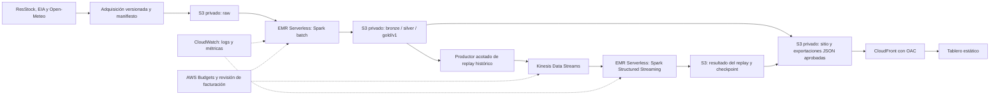

# Arquitectura AWS por etapas

**Estado:** diseño técnico para el demostrador académico. Lo descrito en las secciones 2 a 6 es la **arquitectura objetivo**, no el estado implementado. La última evidencia operativa registrada es del 2026-11-18 y no se revalidó en esta revisión (sin consulta a la consola): AWS Academy Learner Lab, región observada `us-east-1` (N. Virginia); bucket S3 privado con prefijos `gold/` y `site/` (versionado observado deshabilitado); EMR Serverless con permisos denegados y sin aplicación ni job; Kinesis con formulario accesible pero sin stream; CloudFront con lectura parcial denegada y sin distribución verificada; sin evidencia de AWS Budget creado. Detalle en [viabilidad-learner-lab.md](viabilidad-learner-lab.md) y [despliegue-s3-demo.md](despliegue-s3-demo.md). El umbral de USD 50 es una referencia de planeación, no un límite duro de gasto.

## 1. Qué pide el curso y qué compromete la propuesta

`Proyecto-Final.pdf` confirma equipos de cuatro, valor de 50 puntos, exposiciones el 30 de noviembre o 1 de diciembre de 2026, entrega de código, base de datos y documentación en Google Classroom, y la prohibición de plagio. El documento no contiene una matriz técnica con criterios y ponderaciones. La plantilla `Big Data Project Proposal Template.pdf` orienta el formato de la propuesta; sus ejemplos no son requisitos adicionales del profesor.

La propuesta V2 aceptada por el profesor compromete el uso de **Amazon S3**, **Amazon Kinesis Data Streams**, **Apache Spark en Amazon EMR** y un tablero interactivo. También plantea análisis de consumo, detección de anomalías, estimaciones y reproducción progresiva de históricos identificada como simulación. Por ello este diseño conserva esos componentes, pero acota su ejecución a una demostración medible. No supone que los 10,000 perfiles o los 350.4 millones de intervalos ya estén procesados.

## 2. Arquitectura objetivo

### Componentes y límites

| Componente | Diseño propuesto | Límite del demostrador |
|---|---|---|
| S3 | Un bucket dedicado al proyecto, privado, con prefijos `raw/`, `bronze/`, `silver/`, `gold/v1/`, `checkpoints/` y `site/data/v1/`. Gold guarda Parquet canónico; el sitio contiene solo exportaciones JSON aprobadas. Manifiestos registran fuente, fecha, hash, esquema y versión del código. | Subir solo una muestra seleccionada y derivados autorizados. Habilitar versionado (observado deshabilitado el 2026-11-18); no sobrescribir datos de entrada ni salidas de una publicación ya emitida. |
| Spark batch en EMR Serverless | Un job de corta duración lee la muestra desde S3, valida el contrato y produce Silver/Gold Parquet en `gold/v1/`; genera además JSON versionado para el tablero en `site/data/v1/`. El mismo código se desarrolla primero en local. | Configurar máximo de trabajadores, vCPU, memoria y almacenamiento temporal. Una ejecución pequeña, medición, parada y revisión antes de ampliar. |
| Replay con Kinesis | Productor de prueba lee un segmento histórico ya validado y envía eventos con `replay_id`, `event_time` original, `ingested_at_utc`, `sequence`, fuente y `is_replay=true`. | Límite de eventos y duración configurables; comenzar con una prueba pequeña. El evento de fin del lote debe permitir detener el consumidor Spark; no dejar un stream infinito activo. |
| Spark Structured Streaming | Job EMR Serverless consume Kinesis, aplica el esquema y controles, y escribe resultados idempotentes a S3 con checkpoint específico del `replay_id`. | Una reproducción acotada; cancelar/parar tras recibir el marcador de fin y verificar el resultado antes de limpiar el checkpoint. |
| Tablero | Conservar la web estática existente y sustituir datos embebidos por `site/data/v1/manifest.json` y exportaciones JSON con nombre basado en SHA-256. CloudFront entrega la página y únicamente esos JSON. | Publicar exclusivamente `site/` revisado; Gold en `gold/v1/` queda privado y no se sirve directamente. Nunca exponer `raw/`, `bronze/`, `silver/` ni checkpoints. |
| Observabilidad | CloudWatch Logs para jobs, métricas de filas leídas/escritas, rechazadas, eventos de Kinesis y duración. Etiquetas `project`, `environment`, `owner` y `expires_at` donde el servicio las soporte. | Retención corta explícita para logs de prueba; registrar estimación y costo observado por ejecución. |

## 3. Seguridad y publicación

- Mantener **S3 Block Public Access** habilitado. Para la página, usar CloudFront con Origin Access Control (OAC), un origen S3 REST (no endpoint de website estático) y una política de bucket limitada a esa distribución y a `site/*`. No dar a CloudFront acceso a `gold/v1/`: Gold permanece privado y se publica solo mediante exportaciones explícitamente aprobadas. AWS recomienda OAC para servir una web desde S3 sin hacer público el bucket y conservar HTTPS. [Guía AWS de control de acceso S3](https://docs.aws.amazon.com/AmazonS3/latest/userguide/access-management.html) · [Guía de OAC de CloudFront](https://docs.aws.amazon.com/AmazonCloudFront/latest/DeveloperGuide/private-content-restricting-access-to-s3.html)
- Cifrado S3 administrado por AWS, transporte HTTPS, bucket dedicado y roles separados: productor con permiso de escritura solo en el stream, rol Spark con lectura de entradas/escritura de capas y exportaciones, y CloudFront con lectura solo de `site/*`.
- **Publicación y caché:** escribir exportaciones JSON inmutables con SHA-256 en el nombre y `Cache-Control: public, max-age=31536000, immutable`. Publicar `site/data/v1/manifest.json` al final, con `Cache-Control: no-cache, max-age=0, must-revalidate`. Configurar CloudFront con TTL mínimo 0 y respeto de los encabezados de origen. Después de publicar el manifiesto, invalidar `/site/data/v1/manifest.json`; las exportaciones de nombre inmutable no requieren invalidación. No reemplazar objetos Gold de una publicación existente.
- Usar MFA en la cuenta raíz y no crear llaves raíz. No guardar credenciales, archivos `.env`, tokens ni claves AWS en Git, datos o capturas.
- La cuenta personal será administrada por su titular; los demás integrantes recibirán solo el acceso de proyecto necesario. Antes de cargar datos, seguir [`decision-publicacion-datos.md`](decision-publicacion-datos.md) y respetar atribuciones/licencias.
- La aplicación no necesita backend para este alcance. No añadir API Gateway, Lambda, base de datos administrada, QuickSight o WAF sin una necesidad demostrada y costo revisado.

## 4. Selección de región y compatibilidad

La región observada en el Learner Lab (evidencia del 2026-11-18) es `us-east-1`; la afirmación anterior de `mx-central-1` como región seleccionada queda retirada. Esa es la región del entorno Learner Lab de este proyecto, sujeta a revalidación en la consola antes de la siguiente operación. Una eventual cuenta AWS distinta queda fuera del alcance actual y no bloquea el proyecto. Las notas de compatibilidad siguientes provienen de la documentación de AWS y deben revisarse para `us-east-1`; para `mx-central-1` se citaba EMR 7.10.0 o posterior. El conector de Kinesis para Spark se incluye en EMR Serverless 7.1.0 o posterior; para consumir Kinesis se requiere configurar acceso VPC y conectividad al stream. [Regiones y releases mínimos de EMR Serverless](https://docs.aws.amazon.com/emr/latest/EMR-Serverless-UserGuide/endpoints-quotas.html) · [Conector Kinesis de EMR Serverless](https://docs.aws.amazon.com/emr/latest/EMR-Serverless-UserGuide/jobs-spark-streaming-connectors.html)

Antes del primer despliegue, validar cuotas y estimar el escenario en AWS Pricing Calculator para `us-east-1` (Learner Lab), incluyendo endpoints VPC, solicitudes/datos S3, Kinesis, EMR, CloudWatch, CloudFront y transferencia. La disponibilidad de entrega directa de Kinesis a S3 en `us-east-1` no está verificada (se citaba como no disponible en `mx-central-1` según la [tabla regional de Kinesis Data Streams](https://aws.amazon.com/kinesis/data-streams/pricing/)); el diseño asume Spark como consumidor y escritor S3. Los jobs EMR Serverless de streaming son de larga duración y no admiten un timeout de ejecución; implementar un marcador de fin y una detención verificada para el replay finito. [Jobs de streaming de EMR Serverless](https://docs.aws.amazon.com/emr/latest/EMR-Serverless-UserGuide/jobs-streaming.html) Revisar la tabla regional y disponibilidad el día de la prueba.

## 5. Control de costo y puerta de autorización

El umbral mensual propuesto para la demostración es **USD 50**. Es un límite operativo para alertas y planeación, no una garantía de que AWS detenga el consumo al llegar a esa cifra. Antes de crear servicios, documentar una estimación con fecha, región, duración, muestra/bytes, solicitudes y eventos, y ajustar el alcance si el costo previsto no cabe. Usar [AWS Pricing Calculator](https://calculator.aws/) para:

| Servicio | Variables que se deben estimar |
|---|---|
| S3 | GB-mes por prefijo/clase, PUT/GET/LIST, tamaño/particiones, salidas y transferencias; incluir versionado y retención de versiones previas. |
| EMR Serverless | vCPU-segundos, memoria GB-segundo, almacenamiento temporal y duración de cada job; incluir el minuto mínimo de cobro y el tiempo hasta detener trabajadores. |
| Kinesis Data Streams | Modo provisionado u on-demand, shards/horas o datos de entrada/salida, retención y duración del stream. Kinesis Data Streams no está actualmente en Free Tier. |
| VPC | Endpoints necesarios por zona, tráfico; comparar con cualquier alternativa de NAT antes de crearla. |
| CloudWatch | Volumen y retención de logs, métricas y alarmas. |
| CloudFront | Solicitudes y transferencia saliente estimadas para la exposición; contar invalidaciones del manifiesto y confirmar que las exportaciones inmutables aprovechan la caché de largo plazo. |

El costo de EMR Serverless depende de vCPU, memoria y almacenamiento consumidos por los workers; se factura desde que están listos, por segundo con mínimo de un minuto, además de los servicios asociados. [Precios oficiales de EMR](https://aws.amazon.com/emr/pricing/) Kinesis factura según modo/capacidad y uso; no se asumirá que una prueba pequeña es gratuita. [Precios de Kinesis Data Streams](https://aws.amazon.com/kinesis/data-streams/pricing/)

Configurar una alarma de AWS Budgets con umbrales de aviso acordados (por ejemplo, 50/80/100%). Esto **no es un tope duro**: la información de costos puede tener retraso y una notificación puede llegar después de superar el umbral. Complementarla con máximos del job EMR, duración corta, sin capacidad preinicializada, stream creado solo para la prueba, límite de eventos, y verificación manual de terminación/borrado al finalizar. [Retraso y funcionamiento de Budgets](https://docs.aws.amazon.com/cost-management/latest/userguide/budgets-managing-costs.html) · [Acciones de Budgets](https://docs.aws.amazon.com/cost-management/latest/userguide/budgets-controls.html)

Antes del primer despliegue deben quedar anotados: titular de facturación, configuración real de AWS Budgets con alertas a 50/80/100% del umbral mensual, servicio/escenario calculado, destinatario de notificaciones, responsable de detener recursos y evidencia final de limpieza. No hay evidencia de que un AWS Budget exista ni de un tope duro; el medidor del Learner Lab (USD 0.50 de USD 50 observado) no es un presupuesto mensual ni una garantía de gasto. Mientras falte presupuesto configurado y validado, continuar localmente y no crear recursos facturables.

## 6. Etapas de implementación y criterios de salida

| Etapa | Trabajo | Evidencia para pasar |
|---|---|---|
| 0. Congelar contratos localmente | Confirmar IDs/campos/unidades/huso de las muestras; correr transformaciones pequeñas localmente; separar resultados validados de la selección candidata. | Schema v1, reporte de calidad y comandos locales reproducibles. Sin recurso AWS. |
| 1. Preparar cuenta y presupuesto | En `us-east-1` (Learner Lab; revalidar en consola), confirmar titular, MFA, acceso mínimo, cuotas y endpoints; calcular el escenario y crear AWS Budget mensual de USD 50 (pendiente; sin evidencia de creación) con avisos a 50/80/100%. | Estimación fechada y alerta visible en la cuenta; destinatarios verificados; no compartir credenciales. |
| 2. S3 privado y publicación web | Crear bucket dedicado, Block Public Access, versionado, cifrado y roles/policies; CloudFront OAC lee `site/` solamente; establecer `gold/v1/`, `site/data/v1/`, metadatos de caché y publicación de manifiesto al final. | Acceso directo al bucket denegado; web servida por HTTPS; datos Gold/raw/Silver inaccesibles públicamente; manifiesto actualizado tras publicar; exportaciones inmutables servidas desde caché. |
| 3. Lote Spark en EMR | Subir muestra acotada, ejecutar un job con límite de workers, escribir Gold particionado y métrica de ejecución. | Conteos/hash/resultados cotejados con local; runtime/costo observados; workers detenidos. |
| 4. Replay acotado | Crear stream, enviar lote pequeño identificado como replay, ejecutar Spark streaming con VPC/endpoints/checkpoint y marcador de fin. | N eventos enviados/recibidos/procesados, duplicados/rechazos, tiempo, costo y stream/job/checkpoint cerrados. |
| 5. Tablero E2E y entrega | Cambiar la web para leer manifest/Gold reales, probar estados, filtros, despliegue y copia local de respaldo; reunir código, artefactos permitidos y documentos para Classroom. | Ruta demostrable local y cloud, URL/fecha de datos, diagrama implementado y checklist de limpieza cerrado. |

## 7. Puertas de decisión pendientes

1. Acceso autorizado a la cuenta AWS, titular de facturación, responsable de alertas y permisos mínimos.
2. Configurar y verificar el AWS Budget de USD 50/mes en el Learner Lab (`us-east-1`); calcular un máximo operativo por ejecución. El Budget alerta, no detiene automáticamente el gasto.
3. Número de perfiles/intervalos que se subirán. Los 10 actuales son el piloto procesado; el índice de 10,000 IDs es candidato, no una descarga.
4. Duración y número máximo de eventos para el replay, además de retención de stream/checkpoint.
5. Qué artefactos Gold son redistribuibles y pueden ser públicos a través del tablero.

Este documento desarrolla el stack aprobado como objetivo. Implementado y observado (2026-11-18): solo el bucket privado con `gold/` y `site/`. Pendientes: revalidar `us-east-1` en consola, configuración de cuenta, Budget y alertas, estimación de ejecución, y EMR, Kinesis y CloudFront (permisos denegados o sin crear).
