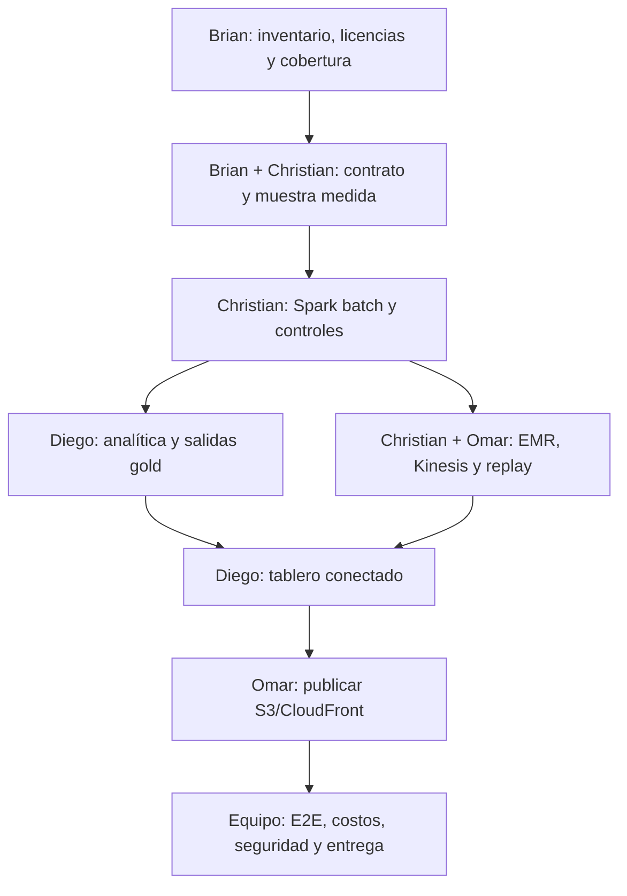

# División detallada de tareas por integrante

**Proyecto:** Análisis, predicción y detección de anomalías del consumo eléctrico residencial  
**Meta interna:** completar un demostrador integrado, reproducible y desplegado conforme a los requisitos de la propuesta V2.  
**Base de planeación:** [Plan de ejecución integral para alcanzar 90%](plan-ejecucion-integral-90.md) y propuesta V2 aprobada.

> Esta asignación distribuye el trabajo pendiente; no afirma que las tareas estén iniciadas o completadas. El 90% es una meta del equipo, no una calificación del profesor. Las tareas con costo cloud quedan sujetas a que exista cuenta, responsable de facturación y presupuesto máximo acordado.

## 1. Reglas de trabajo para los cuatro integrantes

1. Toda tarea debe terminar con evidencia revisable: commit/PR, archivo de salida, captura, log resumido, métrica o instrucción reproducible.
2. Cada integrante es responsable de su bloque, pero sus datos, código e interpretación los revisa otra persona antes de integrarlos.
3. Ningún resultado se presenta como terminado por tener solo un diseño, una tarea iniciada o una pantalla dibujada; debe ejecutarse y comprobarse.
4. Los datos modelados de ResStock, las ventas oficiales EIA y el clima conservan identificadores, coberturas y unidades separados.
5. El replay de Kinesis se etiqueta como reproducción de históricos, con fechas originales; no se presenta como conexión en vivo a hogares.
6. No se incluyen claves, secretos, archivos `.env`, datos personales ni datos fuente cuya redistribución no esté autorizada en Git, capturas ni Classroom.
7. Cambios que afecten el alcance aprobado, el uso de datos o el presupuesto se anotan y se someten al equipo antes de aplicarlos.
8. La rama de integración se mantiene funcional; cada bloque entra mediante PR pequeño con pasos para repetirlo.

## 2. Resumen de responsables

| Integrante | Responsabilidad principal | También apoya | No es responsable de aprobar por sí solo |
|---|---|---|---|
| **Brian Garcia Mares (22030511)** | Investigación, extracción y gobernanza de datos | Validación semántica de cifras del tablero; cobertura de fuentes | Ampliar o publicar datos sin revisar términos, cobertura o tamaño |
| **Omar Gadiel Bolaños García (22030591)** | Cuenta AWS, nube, despliegue e integración | Coordinación técnica, registro de costos, documentación de operación y paquete final | Presupuesto, gasto o resultados de datos/analítica sin revisión de equipo |
| **Christian Raul Páramo Bautista (22031149)** | Ingeniería de datos, Spark y calidad | Reproducción Kinesis, trazabilidad y métricas de rendimiento | Declarar que anomalías/predicciones son válidas sin revisión analítica |
| **Diego Emilio Ortiz Vilchez (22030642)** | Analítica, anomalías, predicción y experiencia del tablero | Contrato de salida de datos y revisión de gráficas | Interpretar como causalidad o precisión una comparación de poblaciones distintas |

## 3. Brian Garcia Mares — datos, fuentes y gobernanza

### Objetivo del rol

Entregar conjuntos de entrada entendidos, trazables y compatibles con el análisis, y garantizar que el equipo no confunda perfiles modelados, estadísticas oficiales y clima.

### Tareas detalladas

#### A. Inventario y permisos

- Crear un inventario por fuente: ResStock, EIA residencial, Open-Meteo y, solo si se justifica, EIA-930 como contexto de la red.
- Para cada fuente registrar URL/API, fecha de consulta, versión, periodo, geografía, categoría/sector, resolución, unidades, formato, tamaño, filas y método de descarga.
- Confirmar avisos de licencia, atribución y uso; identificar por separado si se permite guardar el crudo, publicar resultados derivados o adjuntar datos a Classroom.
- Mantener un manifiesto de archivos con SHA-256 y una explicación de cómo reobtener los datos si no se pueden redistribuir.
- Revisar avisos de columnas del release ResStock 2025.1 y documentar qué representa cada campo utilizado.

#### B. ResStock

- Confirmar con Christian la clave de análisis, las columnas obligatorias, unidades, timestamps y criterio de perfil válido antes de descargar a escala.
- Obtener un índice de candidatos por estado y tipo de vivienda; estimar bytes por perfil con una muestra pequeña.
- Proponer y documentar una extracción estratificada de hasta la meta de 10,000 perfiles de la propuesta, distribuida por estado/tipo conforme a disponibilidad. La muestra se limita por un gate de factibilidad, no por descarga indiscriminada.
- Registrar cantidad solicitada, obtenida, fallida, bytes y tiempo. No afirmar 10,000 hasta que el manifiesto y los archivos confirmen ese conteo.
- Revisar si hay cobertura geográfica suficiente para una unión climática por estado, condado, zona u otra clave real del dataset.

#### C. EIA y Open-Meteo

- Obtener serie EIA residencial mensual de varios años para estados/sectores con definiciones compatibles; revisar estados finales/provisionales y cambios metodológicos.
- Preparar una tabla de cobertura año × estado × sector; comprobar cuántos años permiten reservar datos de evaluación temporal.
- Consultar a Christian sobre zona horaria/granularidad y a Diego sobre los campos que necesita cada visualización.
- Proponer cobertura climática compatible con ResStock. Si el archivo solo soporta estado, no tratar una sola estación/punto de Denver como representativa sin mostrar que es un proxy.
- Obtener una muestra climática acotada con variables y unidades justificadas; registrar términos y atribución requeridos.
- No integrar EIA-930 dentro de la serie residencial; si el equipo lo incluye, entregarlo como dataset de red separado.

#### D. Entregables

1. `docs/catalogo-datos-final.md` con tabla de fuente, campo, periodo, cobertura, resolución, unidad, licencia, atribución y limitaciones.
2. Manifiesto JSON/CSV con archivos, hash, bytes, filas, estado de descarga y fecha.
3. Scripts de descarga idempotentes con argumentos de periodo/estado; credenciales fuera del repositorio si alguna fuente llegara a requerirlas.
4. Tabla de cobertura EIA multianual y decisión sobre el periodo de entrenamiento/prueba.
5. Nota de viabilidad de la meta ResStock 10,000 perfiles con volumen medido y recomendación de alcance.

#### E. Criterios de cierre

- Christian puede leer los archivos en forma reproducible y explicar la procedencia de cada columna de análisis.
- Los hashes, tamaños y conteos coinciden con el manifiesto.
- Diego puede identificar la población representada por cada gráfico y periodo.
- Se ha registrado qué archivos pueden publicarse y cuáles deben recuperarse mediante scripts/instrucciones.
- Las diferencias espaciales y temporales que impiden una unión se hacen visibles, no se rellenan con supuestos silenciosos.

#### F. Revisiones y coordinación

- Recibe revisión de unidades/esquema por Christian.
- Pide a Diego una lista de variables, filtros y agregados requeridos para el tablero.
- Omar revisa cómo organizar el traslado a S3 sin exponer crudos ni secretos.

## 4. Omar Gadiel Bolaños García — AWS, nube, integración y entrega

### Objetivo del rol

Ser el responsable operativo de preparar y administrar el entorno AWS del proyecto, conectar los componentes acordados y entregar un despliegue reproducible, seguro, medido y apagable. Tu responsabilidad principal es la nube; la creación de la cuenta es solo el primer paso, no el proyecto entero.

### A. Preparación y administración segura de la cuenta

Estas tareas se realizan en la consola oficial y con acceso autorizado del titular de la cuenta. No poner contraseñas, códigos MFA, llaves ni capturas con datos sensibles en el repositorio.

1. **Confirmar titularidad y facturación:** definir qué persona será dueña legal de la cuenta, qué método de pago/credito se usará, quién recibirá alertas y qué presupuesto máximo acepta el equipo. No cargar un método de pago ni activar servicios si el equipo no autorizó ese límite.
2. **Proteger la raíz (root):** asociar correo y teléfono de recuperación controlados por el titular, activar MFA, no usar el usuario root para desarrollo diario, no crear access keys root, resguardar el acceso de recuperación fuera del repo y limitar root a las tareas excepcionales que lo requieran. No compartir con el equipo la contraseña root, el dispositivo MFA ni sus códigos.
3. **Asegurar acceso de trabajo:** activar IAM Identity Center si está disponible; dar acceso nominal a cada integrante que necesite consola/CLI con permisos mínimos por tarea y credenciales temporales. Si no está disponible, usar roles/usuarios IAM individuales y acotados; nunca compartir contraseñas o `access key` entre el equipo.
4. **Verificar cuenta y región:** confirmar que la cuenta tiene acceso a `mx-central-1`, EMR Serverless y Kinesis, validar cuotas de servicio y la versión Spark disponible. Documentar alternativa regional solo si disponibilidad, cuota o precio bloquean la ruta.
5. **Configurar control de gastos:** acordar un monto máximo con el equipo; preparar estimación en AWS Pricing Calculator para S3, Kinesis, EMR Serverless, endpoints de VPC, CloudFront, logs y transferencia; configurar AWS Budgets/alertas. AWS actualiza los datos de facturación usados por Budgets al menos diariamente y sus acciones solo cubren recursos/permisos compatibles; no son un corte universal ni instantáneo. El runbook debe detener jobs y retirar recursos facturables directamente.
6. **Registrar decisiones sin datos sensibles:** guardar en `docs/operacion-cloud.md` la región, fecha de configuración, servicios activos, responsables y alertas. No guardar número de tarjeta, cuenta bancaria, tokens, ARN privados no necesarios, IDs sensibles o salida completa de credenciales.

> El usuario pidió que Omar se encargue de crear y usar la cuenta. Eso no implica compartir la raíz ni que Omar pague unilateralmente. El titular, el presupuesto y el consentimiento de gasto se acuerdan con el equipo antes de activar servicios cobrables.

AWS recomienda proteger el root, no compartir sus credenciales ni crear sus access keys, y usar identidades individuales con permisos mínimos/credenciales temporales para el trabajo diario. [Buenas prácticas de root](https://docs.aws.amazon.com/IAM/latest/UserGuide/root-user-best-practices.html), [buenas prácticas para administradores](https://docs.aws.amazon.com/signin/latest/userguide/best-practices-admin.html), [buenas prácticas de IAM](https://docs.aws.amazon.com/IAM/latest/UserGuide/best-practices.html). Budgets refresca el costo al menos una vez al día y las acciones dependen de recursos/permisos compatibles; por ello, el equipo debe confirmar el stop/cleanup de los servicios utilizados. [Buenas prácticas de AWS Budgets](https://docs.aws.amazon.com/cost-management/latest/userguide/budgets-best-practices.html), [acciones de presupuesto](https://docs.aws.amazon.com/cost-management/latest/userguide/budgets-controls.html).

### Ruta personal para aprender a operar AWS en este proyecto

Esta es la secuencia concreta de lo que harás con la cuenta. Los primeros pasos de consola/CLI son de lectura o con recursos de demostración; los pasos que crean servicios se realizan solo después de aprobar el límite de gasto.

1. **Cuenta y costos:** iniciar sesión con identidad nominal; reconocer región, cuenta activa, Billing, Budgets y CloudFormation. No usar root para trabajo diario. Resultado: acceso de trabajo confirmado y checklist de cuenta.
2. **Permisos y terminal:** usar IAM Identity Center/credenciales temporales para consola o AWS CLI; confirmar la identidad activa y la región antes de ejecutar comandos. Resultado: sesión de desarrollo sin claves permanentes compartidas.
3. **S3 — guardar y organizar archivos:** crear o desplegar el bucket privado aprobado, comprender bucket/prefix/object, subir un archivo pequeño autorizado, leerlo, comparar hash y ver la política de bloqueo público. Luego automatizar el envío de `raw/`, `curated/` y `gold/`. Resultado: manifiesto de objetos y carga repetible.
4. **EMR Serverless — ejecutar Spark en la nube:** seleccionar aplicación Spark y runtime aprobado; subir el job; usar el rol de ejecución con lectura en S3 y escritura solo en sus prefijos; ejecutar muestra pequeña y verificar resultados/logs; después estimar la carga de datos objetivo. Resultado: un job reproducible con tiempos, filas y costo observado.
5. **Kinesis — recibir el replay:** crear un stream configurado para el tamaño de la prueba; entender productores, modo de capacidad, retención y registros; enviar pocos eventos de prueba, leerlos/contarlos, dejar vencer la retención breve acordada y eliminar el stream de prueba al cerrar. Resultado: reporte de eventos enviados/recibidos y costo/tiempo.
6. **Kinesis + Spark Structured Streaming:** aplicar el procedimiento con Christian: iniciar Spark consumer/checkpoint, enviar un replay finito, verificar procesamiento y salida a S3, comprobar reintentos/idempotencia y detener el job. Resultado: evidencia E2E de ingestión cloud simulada y parada confirmada.
7. **Publicar tablero:** subir el frontend y gold aprobados al origen S3 privado; publicar mediante CloudFront/OAC; revisar URL HTTPS, permiso de lectura, manifest/caché, vista en escritorio y móvil. Resultado: enlace accesible para profesor sin exponer raw.
8. **Monitorear y cerrar:** consultar logs, trabajos activos, stream, almacenamiento y costos; detener y retirar recursos temporales conforme al runbook. Resultado: captura/registro de cierre y listado de recursos que permanezcan activos.

**No crear por inercia:** una instancia EC2 permanente, NAT Gateway, base de datos RDS/Redshift, clúster EMR persistente o herramienta BI con licencia. La propuesta usa S3 como data lake, Spark en EMR y la aplicación web actual para presentar resultados; agregar otro servicio requiere justificar función, integración y costo. Los Parquet/manifiestos en S3 pueden formar el artefacto de datos del proyecto si el profesor no exige un motor SQL específico.

### B. Infraestructura repetible

- Preparar infraestructura como código (preferentemente plantilla AWS CloudFormation para evitar pasos manuales no repetibles) para:
  - Bucket privado de lake, bucket privado del sitio o prefijos estrictamente separados.
  - Block Public Access, cifrado SSE-S3, TLS, versionado donde sea útil y política de ciclo de vida/retención de temporales.
  - Roles IAM diferenciados para carga, EMR, Kinesis producer/consumer y publicación web.
  - Stream Kinesis en modo de costo adecuado a una demostración pequeña, retención corta y nombres por entorno.
  - Aplicación EMR Serverless Spark con release compatible y máximos de trabajadores explícitos.
  - Roles/log groups/checkpoints S3 y endpoint de VPC requerido para el acceso privado desde EMR.
  - Bucket de aplicación S3 y distribución CloudFront con Origin Access Control; permitir lectura solo de los objetos del sitio/resultados aprobados.
- Etiquetar recursos con proyecto, responsable, entorno y fecha de expiración.
- No activar dos regiones ni recursos duplicados. No crear NAT Gateway salvo que se estime y acuerde su costo; preferir endpoints apropiados cuando sea viable.

### C. Subida reproducible y operación de los datos

- Definir script/CLI que reciba la ubicación local de archivos autorizados, calcule hash y los suba a los prefijos correctos de S3.
- Hacer que la operación sea idempotente: segunda ejecución no duplica objetos/particiones inadvertidamente y compara hash/manifest.
- Implementar `deploy`, `status`, `start`, `stop`, `cleanup` y/o comandos equivalentes con mensajes de seguridad y región explícita.
- Confirmar con Brian que raw no queda público y con Christian que el contrato de almacenamiento mantiene esquema/particiones.
- Revisar una muestra de cada objeto en S3 mediante identidad de sólo lectura; guardar evidencia redactada, nunca credenciales.

### D. EMR y Kinesis

- Coordinar con Christian el bucket de scripts, ruta de entrada/salida, roles, parámetros de workers y configuración de checkpoints.
- Subir el job Spark aprobado a S3 y lanzar primero una muestra de tamaño pequeño; registrar versión EMR, vCPU, memoria, duración, filas y costo estimado/observado.
- Crear el stream Kinesis solo tras confirmar que Spark puede leerlo en la región seleccionada.
- Preparar con Christian el orden de ejecución del replay: cargar fuente en S3 → iniciar consumer Spark → lanzar productor con cantidad máxima/replay ID → validar salida → detener producer/job → verificar recursos y cargos.
- Mantener el job streaming acotado. No dejarlo en ejecución indefinida durante desarrollo o al terminar la sesión.
- Guardar logs técnicos resumidos (job ID redacted si fuera sensible, tiempos, eventos, errores principales y ruta de salida) en `evidencias/cloud/`.

### E. Publicación de la aplicación

- Coordinar con Diego el contrato de los archivos gold (`manifest.json`, tablas por año/estado/periodo y esquema de anomalías/predicción).
- Configurar CloudFront con origen S3 privado/OAC; evitar sitio S3 público y restringir el acceso del rol de publicación a los objetos web.
- Automatizar despliegue del sitio y de salidas gold aprobadas con invalidación/versión del manifiesto; verificar HTTPS, rutas, CORS si aplica, actualización de datos y comportamiento ante archivos faltantes.
- Entregar una URL pública estable para evaluación y conservar una ejecución local de respaldo.
- Nunca desplegar datos crudos en el origen público del sitio.

### F. Costos, seguridad y cierre

- Llevar bitácora por sesión: hora de inicio/fin de stream, job EMR, endpoints, GB procesados, almacenamiento, transferencia y estimación de cargo.
- Antes de crear/recrear recursos, revisar el presupuesto disponible; si la estimación rebasa el tope o un servicio no tiene el comportamiento esperado, detenerse y elevarlo al equipo.
- Verificar que ningún secreto aparezca en Git, bundles frontend, logs del navegador o capturas.
- Ejecutar checklist de cierre después de pruebas: detener EMR, confirmar stream apagado/eliminado, retirar endpoints temporales, borrar checkpoints/replay temporales según retención acordada, mantener los resultados finales necesarios y comprobar el panel de costos/uso.
- Entregar runbook y un reporte de recursos que quedaron activos, con razón y fecha de retiro.

### G. Tareas transversales recomendadas para Omar

- Mantener matriz de trazabilidad de requisito → PR/commit → evidencia.
- Coordinar la integración diaria y resolver dependencias, sin sustituir la revisión técnica de Brian/Christian/Diego.
- Mantener documentos de arquitectura real, decisiones, límites y pasos de Classroom actualizados.
- Preparar paquete final reproducible y ocultar archivos privados, datos no autorizados y secretos.
- Organizar plan de contingencia para presentar demo local si falla Internet o CloudFront en el aula.

### H. Entregables de Omar

1. `infra/` con plantilla CloudFormation parametrizada y README para desplegar/quitar el stack.
2. `scripts/cloud/` con subida/consulta/despliegue/parada/limpieza reproducibles, sin secretos incluidos.
3. `docs/operacion-cloud.md` con responsables, región, política de acceso, topología real, estimación, costos observados y runbook de cierre.
4. `evidencias/cloud/` con capturas/logs redactados de S3, EMR, Kinesis y URL del sitio, más una tabla de tiempo/filas/bytes.
5. URL cloud comprobada y alternativa local.
6. Checklist de Classroom con inventario del código, datos permitidos/instrucciones de recuperación y documentación.

### I. Criterios de cierre de Omar

- La cuenta tiene acceso seguro nominal y MFA del root; no hay secretos compartidos ni guardados en Git.
- Los recursos se recrean con parámetros documentados y permisos mínimos; no existe bucket público accidental.
- Se puede hacer un ciclo de subir → ejecutar → visualizar → detener/limpiar con evidencia.
- El job Kinesis/EMR se detiene al finalizar; los recursos temporales tienen expiración y dueño.
- El gasto observado/estimado está anotado y cabe dentro del límite autorizado por el equipo.
- La aplicación se abre por HTTPS desde fuera del equipo del desarrollador y carga resultados gold actuales.

### J. Revisiones y coordinación de Omar

- **Brian:** procedencia, licencias, hashes, tamaño y autorización de archivos a S3/tablero.
- **Christian:** esquema, particiones, job parameters, checkpoints y consistencia de salida.
- **Diego:** visualización de datos reales, formato y respuesta de la web a nueva versión.
- **Equipo completo:** presupuesto, selección de región, retención, exposición de resultados y eliminación final de servicios.

## 5. Christian Raul Páramo Bautista — Spark, ingeniería y calidad de datos

### Objetivo del rol

Construir el flujo común de datos que funcione localmente y en EMR, produzca salidas verificables y preserve el origen de cada valor.

### Tareas detalladas

1. Definir el contrato de tablas junto con Brian: campos obligatorios, tipos, unidades, grano temporal/geográfico y fuente.
2. Diseñar las capas raw/bronze/silver/gold y el diccionario técnico; acordar particiones que no creen miles de archivos pequeños.
3. Escribir jobs PySpark para leer las muestras actuales y la selección aprobada, validar esquemas y producir Parquet particionado.
4. Implementar controles: columnas/formatos requeridos, nulos, duplicados, rangos, timestamps únicos y ordenados, intervalos de 15 minutos, conversiones kWh/MWh, códigos de estado y suma de entradas/salidas.
5. Mantener las fuentes separadas. Un join solo se ejecuta si el grano estatal/temporal/climático está respaldado por los campos observados.
6. Preparar un consumidor Spark Structured Streaming de Kinesis usando una versión EMR compatible; configurar role, checkpoint, tolerancia a reintentos y salida idempotente en S3.
7. Trabajar con Omar en perfiles mínimos del job, VPC/roles, logs y duración; lanzar localmente antes de un job facturable en nube.
8. Implementar contadores de eventos recibidos, inválidos, duplicados, aceptados y escritos, con replay ID y time range.
9. Medir escala: archivos/bytes, número de particiones, filas leídas/escritas, tiempo de job, workers configurados y consumo/estimación.
10. Entregar una transformación agregada para cada visualización y un manifiesto de resultados que Diego pueda consumir.

### Entregables

- Módulo `src/` o `jobs/` organizado para `batch`, `streaming`, `validation` y `schemas`.
- Configuración versionada sin secretos; parámetros de rutas/estado/año/región desde flags o variables.
- Pruebas pequeñas de esquema/transformación y fixtures sintéticos que no incluyan datos inventados como resultados oficiales.
- Reporte de calidad y resumen de rendimiento.
- Job Spark de lote y job Structured Streaming documentados y ejecutables.
- Ejemplo de evento Kinesis y esquema de salida.

### Criterios de cierre

- Mismo código de transformación se puede ejecutar localmente y en EMR con rutas/configuración distintas.
- Repetir el job no produce duplicados en gold.
- Toda fila inválida aparece en métricas de rechazo con motivo.
- Pasa la comparación de conteos/valores de referencia con la muestra ya documentada.
- Streaming termina al completar el replay; checkpoints y logs se encuentran en rutas conocidas y protegidas.

### Coordinación

- Brian aprueba semántica, campos, permisos y denominadores.
- Omar provee contrato de infraestructura/roles y lanza jobs cloud.
- Diego recibe salidas estables y verifica que agregaciones correspondan a filtros/unidades del tablero.

## 6. Diego Emilio Ortiz Vilchez — analítica, predicción y producto

### Objetivo del rol

Convertir las salidas verificadas en patrones, anomalías, estimaciones y vistas fáciles de explicar, evaluando el método antes de mostrar una afirmación.

### Tareas detalladas

#### A. Especificación de tablero

- Convertir la demo actual en secciones Resumen, Patrones, Clima, Anomalías, Estimaciones y Flujo/Calidad.
- Diseñar filtros globales que realmente afecten las consultas: estado/zona, grupo de vivienda, periodo, fuente y granularidad disponibles.
- Para cada gráfica especificar pregunta que responde, población, fuente, grano, unidad, fórmula, ejes, leyenda, filtros y ejemplo de interpretación.
- Añadir estados de carga, sin datos, dato no comparable y error de carga; conservar responsive, accesibilidad de teclado y contraste.
- Consumir el manifiesto/gold acordado con Christian y Omar; eliminar constantes embebidas como fuente primaria de las vistas finales.

#### B. Anomalías

- Seleccionar una unidad de análisis representada por la fuente (perfil/grupo/serie); escribir qué significa “atípico” antes de seleccionar parámetros.
- Construir una línea base robusta interpretable por temporada/periodo comparable y detectar aumentos, caídas y faltantes como categorías distintas.
- Crear una copia de prueba, inyectar eventos sintéticos etiquetados y conservar data original intacta.
- Separar datos de entrenamiento/umbral y evaluación; medir precision/recall/F1 solo contra etiquetas conocidas de la prueba sintética.
- Preparar 3–5 casos para tablero: observado, valor de referencia, diferencia, score y regla que disparó.
- Etiquetar que el caso sintético demuestra la lógica y no es un evento real del sistema eléctrico.

#### C. Estimación/predicción

- Trabajar con Brian para elegir años EIA con definición/sector/estado comparables.
- Crear partición temporal de prueba al final del historial; nunca mezclar aleatoriamente meses cuando se quiere pronosticar fechas posteriores.
- Implementar primero baseline estacional y después un modelo sencillo si hay suficientes datos.
- Calcular MAE, RMSE, sMAPE, periodo y escala; identificar meses donde la métrica no es interpretable (por ejemplo, denominador próximo a cero).
- Mantener análisis de perfiles ResStock 2018 como perfil/escenario, no como forecast longitudinal probado.
- Entregar forecast mensual/anual desde EIA y diario solo si el modelo y cobertura lo sostienen.

#### D. Integración visual y validación

- Coordinar con Christian el esquema final de JSON/Parquet gold y con Omar el hosting/URL.
- Mostrar procedencia, tipo de fuente, año, unidad y cobertura junto a cada KPI.
- Explicar que el 87.16% es razón de totales con diferentes poblaciones; no titularlo “precisión”.
- Verificar filtros, navegación, interacción mensual, exportación si se incluye, diseño móvil, teclado y consola sin errores.
- Preparar capturas reales y un camino corto para una demo de exposición de 3 minutos.

### Entregables

- Prototipo funcional de las seis vistas conectado a datos externos.
- Especificación de visualizaciones y diccionario de fórmulas.
- Notebook/script analítico reproducible con partición, baseline, métricas y ejemplos.
- Dataset gold esperado, manifiesto de campos y capturas de estados normales/error/vacíos.
- Guion de la demo para el profesor, junto con una copia local de respaldo.

### Criterios de cierre

- Las seis vistas cargan datos versionados, y los filtros cambian resultados.
- Cada cifra puede rastrearse a una tabla, periodo, grupo y fórmula.
- La detección está evaluada en datos etiquetados de prueba; pronóstico usa holdout temporal o está rotulado como escenario.
- Ninguna vista atribuye causalidad al clima ni precisión del modelo a la razón ResStock/EIA.
- La aplicación funciona en desktop y móvil; errores de datos se muestran con un estado claro.

### Coordinación

- Brian valida procedencia, cobertura y significado de la población.
- Christian entrega salidas, calidad y actualización del pipeline.
- Omar despliega los archivos, conecta CloudFront y verifica publicación/caché.

## 7. Dependencias entre bloques

### Contratos que deben acordarse antes de integrar

| Contrato | Propietarios | Se debe fijar antes de |
|---|---|---|
| Identidad, periodo, unidades, zona horaria y campos | Brian + Christian | Leer 10,000 perfiles o implementar joins |
| Prefijos S3, región, roles, rutas y etiquetas | Omar + Christian | Crear recursos billables o lanzar EMR |
| Esquema gold y manifiesto JSON | Christian + Diego + Omar | Implementar páginas finales o publicar CloudFront |
| Labels de anomalía y protocolo de prueba | Diego + Christian | Mostrar lista/score de anomalías |
| Holdout, baseline y métricas del pronóstico | Diego + Brian | Publicar forecast mensual/anual |
| Licencias, presupuesto y retención | Brian + Omar + equipo | Subir datos, publicar o conservar servicios |

## 8. Secuencia de trabajo por responsable

| Fase / dependencia | Brian | Omar | Christian | Diego |
|---|---|---|---|---|
| Contratos y factibilidad de datos | Validar fuentes, cobertura, licencia y metadatos. | Preparar decisión de cuenta, presupuesto y regiones candidatas; sin activar recursos. | Fijar esquema, unidades, llaves y reglas temporales. | Especificar preguntas del tablero y definición de métricas. |
| Muestra reproducible y calidad local | Producir inventario/manifiesto y aclarar población/denominadores. | Integrar los entregables y documentar comandos. | Implementar lectura, validaciones y transformación local. | Consumir tablas locales y validar etiquetas/unidades de las visualizaciones. |
| Puerta cloud | Aprobar procedencia/alcance de datos a cargar. | Configurar acceso mínimo y presupuesto aprobado; preparar S3 privado y registro de costos. | Validar roles/rutas de entrada/salida y requerimientos de EMR/Kinesis. | Definir qué resultados Gold pueden publicarse en la web. |
| Spark batch y analítica | Contrastar cobertura y significado de los resultados. | Ejecutar solo con presupuesto y parámetros aprobados; medir costos y tiempos. | Ejecutar Spark batch, controles, particiones y Gold. | Implementar análisis descriptivo, detección explicable y evaluación temporal. |
| Replay y aplicación integrada | Revisar semántica de eventos y etiquetado como simulación. | Crear/cerrar recursos temporales y comprobar CloudFront/S3. | Implementar productor/consumidor, Kinesis, checkpoints y salida idempotente. | Conectar vistas y filtros a Gold/replay y comprobar estados de uso. |
| Aceptación y entrega | Revisar atribución, cifras y manifiesto final. | Auditar costo, seguridad, URL, limpieza y runbook. | Aportar evidencia E2E de ingesta/calidad/procesamiento. | Revisar interfaz, métricas, accesibilidad y explicación de resultados. |

Cada fase inicia cuando la evidencia de su dependencia está disponible. Las tareas sin dependencia directa pueden avanzar en paralelo; ninguna etapa cloud empieza antes de aprobar costo y acceso.

## 9. Ceremonias y definición de terminado

### Revisión diaria (15 minutos)

Cada integrante reporta: qué quedó integrado ayer, qué evidencia generó, qué hará hoy y qué bloqueo necesita resolver. Omar registra bloqueos e interfaces, pero cada dueño confirma su propio resultado.

### Revisión de integración (final de cada bloque)

- Quien desarrolla abre PR con propósito, archivos/rutas, comando para repetir, evidencia y resultado observado.
- Un segundo integrante revisa cálculo, semántica o seguridad según el tipo de cambio.
- Si cambia infraestructura/costo, revisión obligatoria de Omar y de al menos un integrante que no la implementó.
- Si cambia unidad/población, revisión de Brian y Diego.
- Si cambia salida de datos, revisión de Christian y Diego.

### Definition of Done

Una tarea se marca **Completada** cuando:

1. El entregable existe en la rama/repositorio acordado.
2. La ejecución o consulta correspondiente se repitió y el resultado está anotado.
3. Un par revisó los números/permisos/interacción relevante.
4. La documentación y la limitación restante están actualizadas.
5. La evidencia no contiene secretos ni datos no publicables.

Estados de seguimiento: `Pendiente`, `En curso`, `En revisión`, `Completada` y `Bloqueada`. Aceptar una tarea en el chat o tener una pestaña/job abierto no es evidencia de finalización.

## 10. Plan alterno y límites de responsabilidad

- **Cuenta o presupuesto no disponible:** Omar no sustituye el acceso por credenciales compartidas. El equipo conserva procesamiento local y solicita habilitación/decisión del profesor; la nube se informa como bloqueo.
- **10,000 perfiles no factibles:** Brian entrega medición y opciones; Christian calcula volumen y costo de procesamiento; equipo decide alcance y consulta al profesor. Nadie reduce el alcance sin registro.
- **Sin join climático válido:** Brian y Christian explican el desajuste; Diego presenta la serie de clima por separado, sin correlación afirmada.
- **Sin suficiente serie histórica:** Diego muestra análisis descriptivo y baseline experimental, sin llamarlo pronóstico validado.
- **Kinesis/EMR se queda activo:** Omar ejecuta el stop/cleanup, documenta cargos y confirma por consola/estado que ya no hay jobs/recursos temporales activos.
- **Falla del hosting público:** Omar revisa URL/distribución; Diego lleva demo local y exportes gold a la exposición.

Esta división convierte el plan integral en trabajo asignable, pero no sustituye una aprobación de gasto ni una rúbrica técnica adicional. Si el profesor entrega una rúbrica separada, actualizar las tareas y criterios contra cada línea de ella antes de cerrar el 90%.
