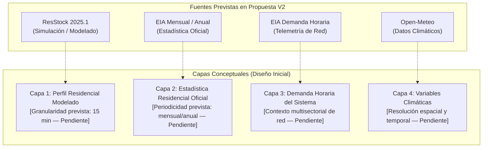

# Esquema Conceptual Inicial y Controles de Calidad Candidatos

**Revisión de avance:** 17 de noviembre de 2026 — Asignatura de Big Data  
**Base documental:** Propuesta V2 (19 de octubre de 2026) y [`docs/descripcion-del-proyecto.md`](descripcion-del-proyecto.md)  
**Estado:** Avance parcial de diseño conceptual. No contiene reglas definitivas ni datos descargados; todos los atributos están sujetos a verificación en archivos crudos.

---

## 1. Propósito y Separación Conceptual de Capas

El propósito de este diseño preliminar es establecer una estructura conceptual mínima que impida mezclar datos simulados, estadísticas oficiales agregadas, demanda general de red y registros climáticos.

> [!IMPORTANT]
> Este documento expone únicamente **campos y controles candidatos**. Ninguna regla o umbral numérico se considera definitivo ni aprobado hasta su contraste con una muestra real descargada.

---

## 2. Definición de Capas y Alternativas de Fuente

1. **Capa 1 — Perfil Residencial Modelado:**
   - *Origen previsto:* ResStock 2025.1 (simulaciones del NREL/DOE basadas en año meteorológico 2018).
   - *Naturaleza:* Datos simulados por modelo físico a nivel vivienda/arquetipo. No representan consumo físico real de medidores inteligentes.
   - *Estado:* Granularidad de 15 minutos, nombres de columnas, unidades (kWh o kW) y huso horario (UTC o Local Standard Time) están **[Pendientes de confirmación en muestra]**.

2. **Capa 2 — Estadística Residencial Oficial:**
   - *Origen previsto:* Publicaciones oficiales de la EIA para el sector residencial por estado.
   - *Alternativas técnicas a verificar:* Formulario EIA-861, Electric Power Monthly o endpoints de la API v2 de EIA **[Pendiente de selección]**.
   - *Naturaleza:* Consumo agregado macro (ventas/facturación estatal). No posee detalle por hogar ni resolución horaria.

3. **Capa 3 — Demanda Horaria del Sistema Eléctrico:**
   - *Origen previsto:* Publicaciones horarias de demanda de la red eléctrica de EIA para los 48 estados contiguos.
   - *Alternativas técnicas a verificar:* EIA-930 o API v2 de demanda horaria por Balancing Authority **[Pendiente de selección]**.
   - *Naturaleza:* Telemetría global de balance de red (incluye industria, comercio, residencial y pérdidas). Funciona como contexto de la red y no sustituye al consumo domiciliario.

4. **Capa 4 — Datos Meteorológicos Históricos:**
   - *Origen previsto:* API histórica de Open-Meteo (temperatura y variables complementarias).
   - *Naturaleza:* Datos de reanálisis meteorológico exógenos; no se etiquetarán como mediciones directas de una estación si provienen de la API histórica.
   - *Estado:* En la consulta piloto se observó temperatura horaria en °C y UTC para un punto de Denver. Se usó `Best Match` predeterminado; fijar un modelo y una cobertura espacial representativa sigue **[Pendiente]**.

---

## 3. Campos Candidatos (Contrato Preliminar)

Las siguientes tablas presentan los atributos mínimos propuestos. Todo campo, tipo y unidad se cataloga como preliminar hasta inspeccionar los archivos fuente.

### 3.1 Perfil Residencial Modelado (`perfil_residencial_modelado`)

| Campo Candidato | Tipo Sugerido | Significado Previsto | Unidad Prevista | Base Temporal / Zona Horaria | Estado de Confirmación |
|---|---|---|---|---|---|
| `building_id` | Alfanumérico | Identificador de arquetipo simulado | Adimensional | N/A | Pendiente de confirmar en cabecera |
| `timestamp` | Marca temporal | Inicio/fin del intervalo de simulación | ISO 8601 | Previsto 15 min; zona horaria **[Pendiente]** | Pendiente de inspección |
| `energy_consumption` | Numérico | Consumo neto simulado | Previsto kWh o kW | Intervalo modelado | Pendiente de confirmación |
| `state_code` | Texto (2 letras) | Estado federado | ISO 3166-2:US | N/A | Previsto en propuesta |
| `source_type` | Texto constante | Etiqueta de capa (`'modelado_resstock'`) | Texto | N/A | Regla de diseño interno |

### 3.2 Estadística Residencial Oficial (`estadistica_residencial_oficial`)

| Campo Candidato | Tipo Sugerido | Significado Previsto | Unidad Prevista | Base Temporal | Estado de Confirmación |
|---|---|---|---|---|---|
| `state_code` | Texto (2 letras) | Estado federado | ISO 3166-2:US | N/A | Previsto en propuesta |
| `period` | Texto / Fecha | Año (AAAA) o Año-Mes (AAAA-MM) | Calendario civil | Mensual / Anual | Pendiente de selección de endpoint |
| `residential_sales` | Numérico | Volumen de ventas residenciales | MWh o miles de kWh | Período reportado | Pendiente de verificar en EIA |
| `source_type` | Texto constante | Etiqueta de capa (`'oficial_eia'`) | Texto | N/A | Regla de diseño interno |

### 3.3 Demanda Horaria del Sistema (`demanda_horaria_sistema`)

| Campo Candidato | Tipo Sugerido | Significado Previsto | Unidad Prevista | Base Temporal / Zona Horaria | Estado de Confirmación |
|---|---|---|---|---|---|
| `grid_region_id` | Alfanumérico | Clave de red o Balancing Authority | Código EIA | N/A | Pendiente de verificar en fuente |
| `timestamp` | Marca temporal | Momento de registro de demanda | ISO 8601 | Horario; UTC vs Local **[Pendiente]** | Pendiente de verificar en fuente |
| `system_demand` | Numérico | Demanda multisectorial de la red | Megavatios (MW) | Registro horario | Pendiente de verificar en fuente |
| `source_type` | Texto constante | Etiqueta de capa (`'sistema_eia_red'`) | Texto | N/A | Regla de diseño interno |

### 3.4 Datos Meteorológicos Históricos (`clima_historico`)

| Campo Candidato | Tipo Sugerido | Significado Previsto | Unidad Prevista | Base Temporal / Zona Horaria | Estado de Confirmación |
|---|---|---|---|---|---|
| `location_ref` | Alfanumérico | Coordenada (lat/lon) o zona climática | Grados decimales | N/A | Pendiente de parametrizar |
| `timestamp` | Marca temporal | Momento asociado al valor de reanálisis | ISO 8601 | Horaria; la consulta piloto fue en UTC | Confirmado en la respuesta piloto |
| `temperature_2m` | Numérico | Temperatura de aire a 2 m de un producto meteorológico histórico | °C (preferente) | Horaria; modelo y zona horaria por confirmar | Confirmado en la consulta puntual; el modelo quedó en Best Match predeterminado |
| `source_type` | Texto constante | Etiqueta de capa (`'meteo_open_meteo'`) | Texto | N/A | Regla de diseño interno |

---

## 4. Controles de Calidad Candidatos (Propuestas Iniciales)

Los siguientes controles son **candidatos iniciales** para someter a prueba cuando se disponga de datos. No representan reglas aprobadas ni umbrales definitivos:

* **CQ-C01 — Candidato de Unicidad Temporal-Espacial:** Evaluar si existen registros duplicados para una misma entidad espacial y marca temporal antes de cualquier agregación.
* **CQ-C02 — Candidato de No Negatividad y Límites Físicos:** Proponer la verificación de que el consumo eléctrico no sea negativo ($x \ge 0$) y explorar umbrales preliminares de corte superior según el tipo de vivienda.
* **CQ-C03 — Candidato de Plausibilidad Térmica:** Verificar que las lecturas de temperatura se encuentren en rangos meteorológicos plausibles para la zona, detectando desajustes entre escalas Celsius y Fahrenheit.
* **CQ-C04 — Candidato de Continuidad y Detección de Gaps:** Identificar intervalos de tiempo ausentes evaluando el espaciado temporal real ($\Delta t$) de cada serie.
* **CQ-C05 — Candidato de Normalización Horaria:** Evaluar la trazabilidad de la zona horaria (UTC frente a hora local estándar con o sin horario de verano) para prevenir desfases en correlaciones.
* **CQ-C06 — Candidato de Etiquetado Obligatorio de Origen:** Comprobar que ningún registro carezca de `source_type`, garantizando que perfiles modelados no se acumulen con estadísticas de red.

---

## 5. Secuencia Preliminar de Validación para Muestra Futura

Flujo metodológico propuesto para inspeccionar la primera muestra autorizada que se obtenga:

1. **Recepción e inventario:** Registrar nombre, fuente exacta, fecha de descarga, tamaño y hash SHA-256 del archivo crudo sin modificarlo.
2. **Inspección de cabeceras:** Leer primeras líneas para constatar nombres reales de columnas, separadores y formato (CSV, Parquet o JSON).
3. **Cotejo de esquema:** Comparar campos encontrados contra la sección 3 y resolver atributos marcados como `[Pendiente]`.
4. **Prueba piloto de controles candidatos:** Ejecutar verificaciones preliminares de nulos, duplicados y rangos sobre la muestra sin alterar datos originales.
5. **Documentación de hallazgos:** Registrar en bitácora las unidades y formatos observados como base para el siguiente hito del equipo.

---

## 6. Evidencia y Limitaciones

* **Evidencia consultada:** Alcance y objetivos documentados en `Propuesta_consumo_electrico_V2.docx` y lineamientos de inmutabilidad de [`docs/descripcion-del-proyecto.md`](descripcion-del-proyecto.md).
* **Limitaciones de la versión conceptual:** No se asume un esquema global a partir de un solo archivo y no se definen umbrales numéricos rígidos sin calibración empírica. La muestra posterior se documenta en la sección 7.

## 7. Contraste empírico de la primera muestra

Después de redactar este esquema conceptual se inspeccionó un archivo agregado de ResStock (Colorado, `upgrade=0`, vivienda unifamiliar separada). Para **ese archivo** se confirmaron 96 columnas; campos `in.state`, `in.geometry_building_type_recs`, `timestamp`, `models_used`, `units_represented` y `out.electricity.total.energy_consumption..kwh`; intervalo de 15 minutos; timestamps en EST que marcan el cierre del intervalo; energía en kWh; y agregado ponderado. El archivo tuvo 35,040 intervalos únicos consecutivos, sin nulos ni valores negativos en el campo de energía total.

Estos hallazgos empíricos aplican solo al archivo observado; no convierten todos los campos y reglas candidatos de este esquema en contrato general. Consulte [`resultados-muestra-inicial.md`](resultados-muestra-inicial.md) para procedencia, hashes, contraste mensual exploratorio con EIA y pendientes de alineación climática.

## 8. Contrato técnico de los artefactos inspeccionados

El Parquet piloto individual de Brian también se inspeccionó como estructura y datos, sin ejecutar su script. Para los campos, tipos, llaves y controles confirmados por fuente, consulte [`contrato-datos-v1.md`](contrato-datos-v1.md). Ese contrato conserva pendientes de enriquecimiento geográfico/peso y de autorización de redistribución; no convierte los campos conceptuales de esta propuesta en un pipeline implementado.
