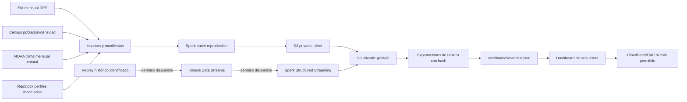

# Plan definitivo general para construir y cerrar el producto

**Estado:** plan rector de implementación del producto final. No representa trabajo ya ejecutado.
**Base de revisión:** `origin/main` en `58c8fe1`, propuesta V2 aceptada, observaciones del profesor, PR #13 y #14 integrados y contraste independiente de Claude.
**Propósito:** reemplazar el enfoque de demos o MVP como entregables por una ruta única de construcción, validación e integración del producto final.

## 1. Resultado que se debe entregar

Una aplicación web de análisis energético residencial de Estados Unidos, respaldada por un flujo reproducible de datos y procesamiento. El producto final debe permitir comparar ventas residenciales de electricidad entre estados y con su contexto demográfico y climático, consultar patrones de perfiles modelados, revisar pronósticos y candidatos de anomalía, y rastrear cada resultado hasta sus datos, versión y reglas de calidad.

El producto debe incluir:

1. Datos EIA mensuales por estado y sector residencial, enriquecidos con población y densidad de Census.
2. Variables climáticas mensuales estatales NOAA/NCEI con procedencia, cobertura y estados de publicación explícitos.
3. Análisis de perfiles residenciales ResStock, manteniéndolos separados de las ventas agregadas EIA.
4. Un modelo de aprendizaje automático para estimar ventas EIA residenciales por estado y mes, evaluado frente a baselines.
5. Detección de cambios atípicos EIA y candidatos de anomalía en perfiles ResStock; resultados sintéticos y observados claramente diferenciados.
6. Dashboard de seis vistas conectado a tablas Gold y manifiestos versionados.
7. Almacenamiento organizado en S3 y procesamiento Spark integrado. Kinesis y un endpoint web estable forman parte del objetivo cloud cuando los permisos reales del Learner Lab permitan ejecutarlos.
8. Código, diccionario de datos, atribuciones, documentación de arquitectura construida y guía reproducible de entrega.

La programación local, los lotes internos y los PRs son medios de implementación. No se presentarán como productos finales separados. El dashboard tampoco se considerará terminado por tener seis pantallas: las vistas deben consumir datos reales procesados y superar los criterios de este plan.

## 2. Decisiones de alcance para el producto final

| Tema | Decisión de producto | Consecuencia para el análisis |
|---|---|---|
| Geografía de comparación | Los 50 estados y DC como jurisdicción separada. | La comparación principal es estatal, porque EIA, la tabla demográfica integrada y el contrato climático utilizan o pueden utilizar esta geografía. |
| Población y densidad | Usar la tabla de Brian, Census Vintage 2025 para población 2020–2025 y superficie terrestre del Censo 2020. | Mostrar por separado población total, densidad y ventas; el campo implementado es `population_density_per_sq_mi`. |
| Comparación energética | Estado × año para totales y valores per cápita, más tendencia EIA mensual por estado. | La mayor población, densidad y venta total son indicadores distintos. La densidad es contexto, no causa demostrada. |
| Comparación por ciudad | No forma parte del producto final definido en este plan. | No se mezclarán ventas estatales de EIA con población de ciudades. La observación del profesor queda atendida mediante comparación entre estados; una afirmación municipal requeriría otra fuente de ventas con igual geografía. |
| Nivel de predicción | Ventas eléctricas mensuales EIA del sector residencial (`RES`) por estado. | El objetivo del modelo es una serie agregada por estado y mes, no el consumo de un hogar. |
| Predicción por vivienda | Fuera del alcance de predicción del producto final. | ResStock aporta perfiles simulados de 2018, no una serie longitudinal observada suficiente para afirmar pronósticos reales de cada vivienda. Sus perfiles sí se usan para patrones y anomalías exploratorias. |
| Modelo de ML | `RandomForestRegressor` global como candidato explícito de aprendizaje automático, comparado con Seasonal Naive y el modelo log-lineal existente. | Solo se declarará mejor si supera las baselines con las mismas observaciones y métricas. “IA” se explicará como aprendizaje automático tabular, no como IA generativa. |
| Clima | NOAA/NCEI mensual estatal para el análisis estatal. La muestra Open-Meteo de dos puntos de Colorado se conserva como fuente puntual separada. | No se presentará la muestra local como clima estatal, ni el pronóstico de pocos días como variable de un pronóstico eléctrico anual. |
| Escala ResStock | El objetivo de la propuesta V2 de 10,000 perfiles se mantiene como meta de escala final; actualmente no está procesada. | 10,000 IDs candidatos no cuentan como perfiles. Un lote de 50 perfiles se reportó procesado localmente (1,752,000 intervalos), pero no equivale al conjunto de 10,000 ni está en el paquete Gold versionado. El resultado final debe contar archivos descargados, aceptados y rechazados después de QC. |
| Servicios cloud | Mantener S3 privado y ejecutar solo componentes que permitan los permisos observados. | La denegación de EMR Serverless, la ausencia de stream Kinesis y el acceso parcial de CloudFront deben documentarse; no se dibujarán como despliegues activos. |

## 3. Estado real que sirve de base

Este estado se contrastó con `origin/main` a `58c8fe1`, el manifiesto Gold v1, el documento de viabilidad de Learner Lab y los PRs integrados. Es evidencia registrada, no una consulta en vivo de la consola AWS.

- **Bloque 0:** el plan general y la asignación de bloques ya están en `main`; persisten contradicciones documentales sobre región, estado AWS, salida del sitio S3, versionado y contratos.
- **Brian:** bloque completado. PR #13 añadió la tabla anual y el script; PR #14 fijó fuentes y aclaró metodología. La salida tiene 306 filas, 51 jurisdicciones × 6 años, y hash/manifiesto reproducibles. No se debe volver a asignar su generación como pendiente.
- **Christian:** bloque de clima estatal mensual pendiente. Su alcance vigente permanece en [`division-bloques-equipo-v2.md`, §4](division-bloques-equipo-v2.md).
- **Diego:** bloque de ML y anomalías pendiente. Su alcance vigente permanece en [`division-bloques-equipo-v2.md`, §5](division-bloques-equipo-v2.md).
- **Dashboard:** seis vistas y Gold v1 están versionados; el manifiesto v1 contiene 10 tablas. Aún no hay `tablero/data/v2` ni integración de la tabla demográfica en el dashboard.
- **Datos ResStock:** Git/S3 registran 10 perfiles de 2018 y 350,400 intervalos. El lote de 50 y 1,752,000 intervalos es una corrida local reportada; no debe anunciarse como artefacto incluido en `main` o S3.
- **EIA/anomalías/estimaciones:** hay una detección estadística EIA y un backtest log-lineal frente a una baseline estacional. No son el modelo Random Forest solicitado y los candidatos estadísticos no son eventos reales confirmados.
- **S3:** existe un bucket privado registrado en `us-east-1`, con prefijos `gold/` y `site/`. La documentación de Learner Lab registra versionado deshabilitado. El HTML se publicó con URL prefirmada temporal; los documentos difieren sobre si la visualización abrió completa. Se debe volver a verificar la build actual.
- **EMR/Kinesis/CloudFront:** EMR Serverless fue denegado; no se creó stream Kinesis; CloudFront tuvo denegaciones de lectura, que no prueban por sí mismas que toda acción del servicio sea imposible.
- **Checkout local:** la copia de trabajo observada seguía en `avance/docs-demo-s3`, anterior a `origin/main`; conservar sus archivos locales sin seguimiento y usar una rama limpia desde `main` para integrar los planes y el trabajo futuro.

## 4. Integrantes y límites de responsabilidad

| Responsable | Estado y alcance que rige | Interfaz con el producto final |
|---|---|---|
| **Brian García Mares** | Bloque completado por PR #13 y #14. No se abre una nueva tarea para rehacer su entrega. | Omar integra el CSV y manifiesto existentes sin alterar su contrato ni autoría. |
| **Christian Raul Páramo Bautista** | Se conserva sin cambios el Bloque 2 de [`division-bloques-equipo-v2.md`, §4](division-bloques-equipo-v2.md). | Entrega NOAA/NCEI mensual estatal con el contrato establecido; Omar incorpora su salida después de revisión. |
| **Diego Emilio Ortiz Vilchez** | Se conserva sin cambios el Bloque 3 de [`division-bloques-equipo-v2.md`, §5](division-bloques-equipo-v2.md). | Entrega modelo ML, comparación con baselines, detección ResStock y artefactos reproducibles; Omar consume esos outputs tras revisar el PR. |
| **Omar Gadiel Bolaños García** | Bloque 4 ampliado en [`plan-bloque-omar.md`](plan-bloque-omar.md): cierra Bloque 0, da por terminado el Bloque 1 de Brian e integra su tabla, dashboard, Gold v2, S3 y la factibilidad cloud. | Omar es propietario del manifiesto/dashboard principal, la integración de outputs, la estructura de publicación y la documentación del estado efectivo AWS. |

Este plan no edita ni reemplaza las tareas individuales ya asignadas a Christian y Diego. Si aparece una incompatibilidad de contrato, se registra y se coordina antes de cambiar el alcance del responsable.

## 5. Contratos de datos definitivos

### 5.1 Demografía y energía anual

Consumir `datos/demografia_estatal/energy_demography_state_year_v1.csv` y su manifiesto, con grano `state_fips × year`, FIPS como texto y el campo de densidad `population_density_per_sq_mi`. La salida ya contiene población, superficie 2020, densidad calculada, ventas EIA residenciales finales y kWh por habitante para 2020–2025.

El contrato vigente del CSV prevalece sobre los nombres antiguos del plan v2. No renombrar el campo silenciosamente; si Gold requiere otro alias, mantener ambos con una migración documentada.

### 5.2 Clima estatal mensual

Consumir la entrega de Christian bajo el contrato acordado: `state_fips,state_code,period,temperature_mean_c,precipitation_mm,hdd,cdd,climate_data_status,climate_source,climate_vintage,source_version`. Grano estado × mes `YYYY-MM`. Se deben exponer faltantes y estado preliminar/final; no rellenar valores sin declararlo.

### 5.3 EIA mensual y ResStock

- EIA: `state_code × period × sector`, ventas en MWh, con `estado_dato` Final/Preliminary preservado. Para comparación estatal y el modelo se selecciona `RES`.
- ResStock: perfiles simulados de vivienda con unidad, identificador y timestamp de origen conservados; el procesamiento local puede derivar UTC y zona IANA antes de formar patrón por hora local.
- No unir ResStock a ventas EIA como si fueran las mismas viviendas. No unir clima puntual Open-Meteo como si representara el estado completo.

### 5.4 Artefactos analíticos y metadatos

Cada dataset Gold debe indicar versión de esquema, grano, claves, unidades, periodo, filas, bytes, SHA-256, fecha de generación, fuente/vintage, código que lo generó y resultado QC. Gold v1 se conserva sin cambios. Las tablas nuevas van a v2.

## 6. Arquitectura final de datos y aplicación



### Prefijos S3 objetivo

```text
<bucket-privado>/
├── raw/<fuente>/<corte>/                 # solo originales permitidos; ResStock crudo no se sube por defecto
├── silver/<fuente>/<schema-version>/      # tablas validadas y normalizadas
├── gold/v1/pilot/                        # preservar los artefactos existentes
├── gold/v2/demografia/                   # salida integrada de Brian
├── gold/v2/clima/                        # salida de Christian
├── gold/v2/analitica/                    # predicción y anomalías de Diego
├── checkpoints/<replay-id>/              # solo para ejecución de streaming activa
└── site/
    ├── releases/<release-id>/index.html
    └── data/
        └── v2/
            ├── <tabla>-<sha256>.json
            └── manifest.json              # publicar al final
```

En disco local, `tablero/data/v2/` será el paquete fuente de exportaciones del frontend. Su mapeo a S3 será explícito: salidas Gold canónicas a `gold/v2/`; solo JSON aprobados para navegador a `site/data/v2/`. Los prefijos S3 son claves/prefijos, no prueba de un servicio activo.

Los insumos que no se puedan redistribuir no se suben a `raw/`: se registra su referencia, licencia, hash, instrucciones de adquisición y transformación. No guardar URLs prefirmadas ni credenciales en el repositorio.

## 7. Secuencia única de implementación

La secuencia es de construcción interna del producto final; no define entregas parciales tipo MVP.

1. **Congelar alcance y estado real.** Omar cierra el Bloque 0: fija fuente de verdad (`origin/main`), contracts, región observada, conteos 10/50/candidatos 10,000 y lista explícita de servicios AWS ejecutados/denegados/pendientes.
2. **Completar fuentes paralelas sin cambiar asignaciones.** Christian termina su clima estatal; Diego su modelo y anomalías según los contratos vigentes. Cada quien entrega su rama/PR y evidencia de reproducción. Brian queda cerrado.
3. **Integrar datos de Brian.** Omar valida hash/cobertura del CSV y construye la representación Gold v2 anual; mantiene el archivo v1 original.
4. **Cerrar el cálculo final de energía-demografía.** Confirmar 51 jurisdicciones, 2020–2025, DC separado, ventas Final de 12 meses y conversión per cápita; exponer rankings separados y dispersión densidad × kWh/persona con población en tamaño/tooltip.
5. **Cerrar contrato climático.** Integrar NOAA con EIA usando estado/mes; mantener Open-Meteo separado. Para predicción solo usar variables conocidas en la fecha de origen, normales climáticas de entrenamiento o pronóstico de clima cuyo horizonte y ubicación se muestren.
6. **Completar producto analítico.** Integrar la predicción mensual estatal RF y baselines; integrar los dos niveles de anomalías. Revisar partición temporal previamente definida y rotular el periodo ya analizado 2024–2025 como backtest previamente observado, no como test virgen.
7. **Alcanzar la escala de ResStock definida por V2.** Validar selección, cuota/estrato, licencias, bytes y capacidad; adquirir y procesar realmente los 10,000 perfiles objetivo por lotes Spark, deduplicando y aplicando QC. No contabilizar IDs candidatos como perfiles. Si el entorno o la licencia impiden llegar a la meta, el producto no se declara conforme a ese requisito: se documenta el faltante exacto y la limitación real, sin fabricar conteos.
8. **Cerrar las seis vistas.** Resumen/Patrones/Clima/Anomalías/Estimaciones/Flujo-Calidad consultan datos Gold v2 y el manifiesto; ejes, filtros, unidades y avisos corresponden a filas reales. Mantener distinción de EIA agregado, ResStock modelado y clima.
9. **Ejecutar la arquitectura cloud permitida.** S3 privado y organizada; Spark local como misma referencia; intentar EMR Serverless y CloudFront solo después de verificar permisos/costos; Kinesis se crea únicamente cuando exista consumidor listo para un replay acotado.
10. **Publicar y verificar release final.** Build con release ID nuevo, JSON con hashes inmutables, manifest publicado al final, bucket privado, navegador sin errores y evidencia local/cloud. Después cerrar guía, diagrama implementado, licencias, comandos y matriz de criterios.

## 8. Aceptación del producto final

- [ ] La tabla de Brian está consumida en Gold v2 y en el dashboard; el esquema conserva `population_density_per_sq_mi`.
- [ ] Christian y Diego cerraron sus entregas de acuerdo con los bloques vigentes, sin que este plan haya alterado su asignación.
- [ ] El producto distingue población, densidad, ventas totales y ventas por habitante; estado mayormente poblado se informa con año y fuente.
- [ ] La comparación energía-demografía usa estados y DC, con unidades y cobertura; no contiene joins de ciudad y estado incompatibles.
- [ ] El modelo RF se comparó contra Seasonal Naive y regresión log-lineal, con MAE/RMSE/sMAPE, predicciones, hashes y limitaciones. Periodos ya consultados se declaran como backtest previamente observado.
- [ ] Anomalías reales candidatas, inyecciones sintéticas y errores de modelo son categorías separadas con sus propias métricas.
- [ ] El objetivo de 10,000 perfiles se demuestra con archivos descargados, roster y QC; los 10 perfiles Git/S3, lote local de 50 e índice candidato se reportan separadamente.
- [ ] El clima estatal NOAA está integrado por estado/mes; Open-Meteo conserva etiqueta puntual y no se afirma causalidad.
- [ ] Las seis vistas consumen Gold v2 y reflejan filas/filtros; no hay valores simulados presentados como reales ni vistas finales vacías.
- [ ] El bucket permanece privado; `raw/`, `silver/`, Gold y exportaciones están separados, con manifiestos/hash y sin secretos.
- [ ] Se realizó al menos un recorrido AWS de los servicios permitidos; EMR/Kinesis/CloudFront aparecen con evidencia como operativo, denegado o no verificado.
- [ ] La build final del sitio se probó en el endpoint que efectivamente esté disponible; URL prefirmada se identifica como temporal, no permanente.
- [ ] Código, fuentes, atribuciones, procedimiento reproducible, diagrama tal como quedó construido y limitaciones están en Git.

## 9. Riesgos y tratamiento

| Riesgo | Tratamiento del plan |
|---|---|
| EMR Serverless fue denegado en la sesión observada. | Mantener Spark local determinista; registrar el error exacto en la próxima revisión. Probar otra forma de ejecutar Spark en AWS solo si la consola y costos lo permiten; no llamar “EMR” a Spark local. |
| Kinesis aún no existe y no hay consumidor cloud probado. | No crear un stream huérfano. Implementar el contrato de replay; crear stream solamente con consumidor listo, límite de evento/duración y cierre comprobable. |
| CloudFront tiene acceso parcial denegado; S3 está privado y el enlace prefirmado expira. | Verificar permisos concretos, intentar OAC si está autorizado. Si no es posible, mantener demo local de respaldo y declarar que no hay URL permanente. No hacer público el bucket como atajo. |
| Learner Lab dura cuatro horas; su medidor USD 50 no es tope duro. | Revisar antes/después, limitar duración y evitar recursos persistentes. La meta interna anotada de USD 5 adicionales es umbral de prudencia, no protección garantizada. |
| Versionado S3 se observó deshabilitado. | Intentar habilitarlo solo si la cuenta lo permite y la retención es costeable. Si no, usar claves inmutables con versión/hash y no sobrescribir releases. |
| El holdout del backtest v1 (2024–2025) ya se vio; existe también análisis de anomalías en 2026 preliminar. | No llamar a esos periodos “test no visto”. Congelar parámetros antes de evaluación adicional; declarar status Preliminary para 2026; reservar nueva ventana de datos cuando exista para una comprobación temporal adicional. |
| Los 10,000 IDs son candidatos; el lote de 50 local no es artefacto versionado. | Validar roster, cuotas/pesos, descarga y QC; solo los archivos efectivamente aceptados cuentan. Mostrar la cobertura no representativa si la selección no es estadísticamente representativa. |
| Reutilización de datos y licencias. | Seguir `docs/decision-publicacion-datos.md`; atribuir y describir transformaciones. No subir crudos si su permiso de redistribución no está respaldado. |

## 10. Relación con la plantilla y entrega

Este plan operacionaliza objetivos, alcance, requisitos de datos, arquitectura, metodología, análisis, despliegue, riesgos, métricas y coordinación de la propuesta V2. No convierte ejemplos ilustrativos de la plantilla en requisitos nuevos. La entrega final debe llevar las secciones académicas solicitadas, el código, las fuentes/derivados autorizados y la documentación reproducible; no basta con enseñar el dashboard o una URL temporal.
