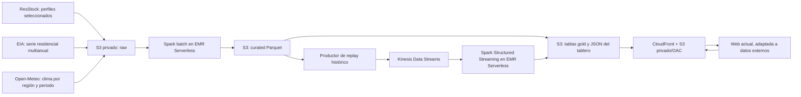

# Plan de ejecución integral para alcanzar 90% del proyecto

**Alcance:** demostrador académico integrado conforme a la propuesta V2.  
**Estado:** plan organizado por requisitos, dependencias y evidencia. Actualización de ejecución al 18 de noviembre de 2026: ya se creó un bucket S3 privado, se cargó la demo autónoma y se guardaron dos tablas Gold más manifiesto/reporte. EMR Serverless negó permisos; Kinesis y CloudFront no están desplegados. Para la sesión temporal del Learner Lab se avanza sin esperar confirmación externa y se usa alternativa local cuando un permiso falta; ver [registro de viabilidad](viabilidad-learner-lab.md).

**Actualización posterior (26-nov-2026):** la ingesta raw final v2 llegó a 10,000 perfiles únicos validados en S3 privado (350,400,000 intervalos); el Gold del dashboard sigue siendo el piloto de 10 perfiles. El procesamiento Spark/QC/Silver/Gold a escala 10,000 aún no está realizado.

## 1. Qué exige el curso y qué propone el proyecto

### Requisitos confirmados en el material del curso

`Proyecto-Final.pdf` establece equipos de cuatro, entrega de código, base de datos y documentación en Google Classroom, y que el proyecto se desarrolle de acuerdo con la propuesta aceptada. El archivo asigna 50 puntos al proyecto, pero no presenta una tabla de criterios técnicos con ponderaciones.

`Big Data Project Proposal Template.pdf` es la plantilla para elaborar la propuesta. Sus fases de 24 semanas, métricas de disponibilidad y tecnologías de ejemplo son material orientativo; no son por sí solas requisitos de calificación del profesor.

**Conclusión de trazabilidad:** en los archivos revisados no aparece una rúbrica separada que obligue al equipo a usar un proveedor, BI o algoritmo específicos. Para respetar el compromiso aprobado, este plan desarrolla el stack de la propuesta V2: **Amazon S3, Amazon Kinesis Data Streams, Apache Spark en Amazon EMR, ResStock, EIA, Open-Meteo y un tablero interactivo**. Si el profesor proporciona otros criterios técnicos, se incorporarán a la matriz de aceptación; el orden de trabajo seguirá las dependencias y requisitos, no las fechas de entrega.

### Compromisos técnicos de la propuesta V2

- Estudio de consumo residencial de Estados Unidos con perfiles ResStock modelados, estadísticas EIA y clima Open-Meteo.
- Objetivo de análisis detallado de al menos 10,000 perfiles y aproximadamente 350.4 millones de registros anuales a intervalos de 15 minutos. Son objetivos de la propuesta, no cifras ya procesadas.
- Preparación reproducible de datos, análisis temporal/regional, anomalías y estimaciones de consumo.
- Reproducción progresiva de históricos para demostrar procesamiento continuo; debe identificarse como simulación, no como telemetría real.
- Tablero interactivo que presenta cobertura, patrones, clima, estimaciones, anomalías y seguimiento del procesamiento.
- AWS S3 para datos y resultados, Kinesis Data Streams para eventos y Spark en EMR para procesarlos.

## 2. Estado de partida comprobado

| Área | Ya existe | Falta para cerrar la propuesta |
|---|---|---|
| Datos (corte inicial del plan) | 10 perfiles ResStock en un Parquet (350,400 filas), selección candidata de 10,000 IDs, 5,304 registros EIA y 336 horas-punto climáticas. | Actualización 26-nov: selección final v2 con 10,000 perfiles raw en S3 privado y 350,400,000 intervalos; Spark/QC/Gold a esa escala aún pendiente. |
| Procesamiento | Contrato de datos, guía Spark, scripts EIA y de preparación, hashes del piloto. | Implementar y ejecutar pipelines Spark reproducibles de lote y flujo, con particiones, linaje, controles y resultados persistentes. |
| Aplicación | Demo web estática local con gráficas y filtros. | Cargar Gold generado desde datos, completar las vistas funcionales y publicar con acceso seguro. |
| Nube | Bucket privado S3, demo HTML y artefactos Gold del piloto ya cargados; URL prefirmada de dos horas verificada. | EMR Serverless fue denegado por permisos; Kinesis no se creó por falta de consumidor cloud; CloudFront no está desplegado. Continuar Spark local y reintentar servicios solo si el entorno lo permite con el costo acotado. |
| Analítica | Comparación exploratoria 2018 ResStock/EIA. | Evaluar anomalías con casos etiquetados y estimaciones con partición temporal; unir clima solo con geografía/tiempo compatibles. |
| Entrega | Repositorio, documentación y demo local. | E2E reproducible, inventario y artefactos permitidos, evidencia de seguridad/costos y paquete conforme a Classroom. |

El 87.16% actual compara un subconjunto modelado de viviendas unifamiliares separadas con las ventas de todo el sector residencial estatal. Se conservará como comparación exploratoria, no como precisión del modelo ni participación real del subconjunto.

## 3. Definición de «90% terminado»

El 90% será una meta interna de **demostrador académico integrado**, no una calificación ni una afirmación de producción nacional. Se alcanza cuando:

1. Se implementaron los flujos requeridos por la propuesta en un alcance de datos medido y se puede repetir su ejecución.
2. S3 conserva capas de datos separadas; Spark procesa en EMR; la reproducción histórica llega a Kinesis y Spark la transforma en salidas consumibles.
3. El tablero cloud consulta salidas reales, no constantes de ejemplo, e incluye las funciones acordadas.
4. Las anomalías y estimaciones cuentan con método, prueba separada y métricas legibles.
5. Una prueba E2E documentada demuestra fuente → S3 → Spark/EMR → resultados → tablero, más el recorrido Kinesis → Spark → resultado.
6. Seguridad, costos, límites de datos y forma de limpiar recursos tienen evidencia.
7. El código, datos permitidos o instrucciones de descarga y documentación se pueden entregar en Classroom.

El porcentaje es una meta interna de avance, no una calificación. El cierre restante corresponde a integración final, revisión por pares, evidencias y ajustes a partir de la evaluación del equipo/profesor. La meta no es declarar completa una plataforma comercial de 50 estados, una predicción validada para cualquier horizonte ni operación 24/7. La meta de 10,000 perfiles debe tratarse como una puerta de factibilidad: antes de ampliarla se medirán licencia, volumen, cuotas y costo; cualquier cambio de alcance se registrará y se consultará con el profesor cuando afecte la propuesta aprobada.

## 4. Arquitectura objetivo para esta entrega

### Servicios y responsabilidades

La arquitectura AWS detallada, con seguridad, costo, región y puertas de despliegue, está en [Arquitectura AWS por etapas](arquitectura-aws-por-etapas.md); este diagrama resume el flujo lógico.

| Componente | Uso acordado | Decisión de diseño |
|---|---|---|
| Amazon S3 | Data lake y resultados | Prefijos `raw/`, `bronze/`, `silver/`, `gold/`, `checkpoints/` y `site/`. Los crudos quedan privados e inmutables; el tablero recibe solo agregados aprobados. Los CSV/Parquet se particionan por fuente, estado, año y mes donde tenga sentido. |
| Apache Spark en Amazon EMR | Batch y procesamiento de eventos | Desarrollar primero y probar localmente con Spark; ejecutar la misma lógica empaquetada como jobs de EMR Serverless para lote y Structured Streaming. Registrar versión de runtime, workers, filas, tiempo y costo. |
| Amazon Kinesis Data Streams | Entrada de eventos de replay | Un productor acotado lee registros históricos preparados, conserva `event_time` original y adjunta `replay_id`, `source`, `state`, `profile_id`, `sequence` y marca `is_replay=true`. No se simulará una conexión de medidores. |
| Tablero web existente | Exploración interactiva | Mantener HTML/CSS/JS y cambiar la carga para leer un `manifest.json` y JSON/Parquet transformados; incluir estado, fecha y cobertura de cada vista. No agregar QuickSight/Power BI salvo que la rúbrica real lo exija: la propuesta no eligió una herramienta BI comercial. |
| S3 privado + CloudFront OAC | Publicación de la aplicación y archivos gold autorizados | CloudFront accede solo al prefijo del sitio/resultados; S3 mantiene bloqueo de acceso público. Raw y checkpoints nunca quedan expuestos. Un dominio personalizado es opcional. |
| Región de AWS | Reducir distancia y aprovechar disponibilidad | Evaluar primero `mx-central-1` porque actualmente ofrece EMR Serverless y Kinesis; validar release mínimo, cuotas, endpoints VPC, disponibilidad de cuenta y costo. Usar una región alternativa solo con decisión documentada. En MX Central se debe escribir a S3 desde Spark; no asumir Kinesis Data Streams S3 Delivery, que no se ofrece en esa región. |

AWS publicó disponibilidad general de EMR Serverless en México Central en mayo de 2026; la tabla vigente señala release mínimo EMR 7.10.0 para esa región. La guía de EMR describe el conector Kinesis para Spark Structured Streaming en 7.1.0 o superior y requiere conectividad de VPC con Kinesis. Estos datos deben revalidarse al crear la infraestructura, junto con cuotas y opciones de endpoint. [Disponibilidad de EMR Serverless en México](https://aws.amazon.com/about-aws/whats-new/2026/05/amazon-emr-serverless-aws-regions/), [releases mínimos por región](https://docs.aws.amazon.com/emr/latest/EMR-Serverless-UserGuide/endpoints-quotas.html), [conector Kinesis para Spark en EMR](https://docs.aws.amazon.com/emr/latest/ReleaseGuide/emr-spark-structured-streaming-kinesis.html).

## 5. Contratos de datos y flujo analítico

### 5.1 Ingesta y trazabilidad

Para cada archivo, registrar fuente/URL o identificador, fecha de consulta, versión, año, estado o zona, tipo de vivienda/sector, licencia/atribución, formato, unidades, tamaño, filas y hash. No almacenar claves en Git ni incluir en Classroom datos cuyo permiso de redistribución no esté confirmado.

### 5.2 Modelo común

Crear un diccionario de campos con al menos:

- `source_type`: perfil modelado, estadística oficial o clima.
- `geography_id`, `state`, `housing_type` cuando aplique.
- `event_time`, `event_time_utc`, `period_start`, `period_end`, `timezone` y granularidad.
- `energy_kwh`, `sales_mwh`, `temperature_c` y valores originales sin convertir, evitando mezclar unidades.
- `model_weight`/`units_represented`, `quality_status`, `source_file`, `ingestion_time`, `run_id` y `replay_id`.

No forzar un join por hora si las fuentes solo coinciden mensualmente. La clave climática deberá ser estado/condado/zona compatible con la geografía disponible de ResStock; mientras esa cobertura no se confirme, clima se mostrará por separado o con una etiqueta de aproximación. Conservar la diferencia entre timestamps EST de ResStock y UTC de la extracción climática antes de cualquier alineación.

### 5.3 Volumen y estrategia de perfiles

1. Obtener índice de archivos, tamaños comprimidos, perfiles, estados y tipologías disponibles; confirmar avisos de columnas y términos del release.
2. Medir muestra estratificada pequeña por estado/tipo; calcular tamaño medio por perfil y rendimiento real de descarga/lectura.
3. Calcular el costo y almacenamiento de 10,000 perfiles antes de pedirlos. Mantener el objetivo de 10,000 como meta de V2, con procesamiento particionado y Parquet; el cálculo de 350.4 millones de intervalos no sustituye el conteo observado.
4. Ejecutar la ampliación en bloques, registrar filas leídas/escritas y abortar de forma controlada al superar cuotas, presupuesto o almacenamiento acordado.
5. Si la fuente no ofrece cada observación/columna necesaria o el volumen excede el almacenamiento, el presupuesto o la capacidad técnica aprobada, preparar una muestra defendible, medirla y escalar la limitación al equipo/profesor antes de declarar alcance final.

### 5.4 Capas de almacenamiento

- **Raw:** originales descargados con hash y manifiesto; escritura única.
- **Bronze:** datos parseados, esquema fiel y procedencia por fila/archivo.
- **Silver:** unidades y tiempo normalizados, duplicados resueltos y controles aplicados; nunca borrar filas rechazadas sin guardar su motivo.
- **Gold:** agregados y features para indicadores, anomalías, pronósticos y tablero.
- **Checkpoints/replay:** aislados de gold; borrables por ejecución una vez preservada la evidencia requerida.

## 6. Funcionalidad final del tablero

El rediseño debe conservar el estilo aprobado y dejar claro el tipo de fuente, unidades, periodo, geografía, cobertura y filtros activos.

1. **Resumen nacional/estatal:** cobertura de datos, perfiles representados, consumo agregado modelado, ventas EIA y última ejecución. Separar perfiles ponderados de ventas observadas.
2. **Patrones:** perfiles por hora/día/temporada/mes, estado y tipología; laborable vs. fin de semana si la fuente lo soporta.
3. **Clima:** serie de temperatura y consumo solo en geografía y tiempo compatibles; explicar que correlación no demuestra causalidad. Si el join geográfico no supera los controles, la vista mostrará capas separadas.
4. **Anomalías:** fecha, estado/grupo, valor observado, referencia esperada, diferencia/score, regla y motivo. Incluir leyenda para datos faltantes y evitar etiquetas de “falla eléctrica”.
5. **Estimaciones:** selector de horizonte, valor estimado, intervalo si el método lo produce, comparación de evaluación y métricas. Un año aislado de ResStock se etiqueta “escenario”, no predicción validada.
6. **Flujo y calidad:** fuente, replay ID, eventos emitidos/recibidos, aceptados/rechazados, latencia de procesamiento medida, último archivo escrito y estado de calidad.

Todos los gráficos tendrán título explicativo, ejes/unidad, leyenda, definición de población, fuente y controles de fecha/estado/tipo. El tablero no mostrará la cifra 87.16% como precisión.

## 7. Plan de analítica y validación

### Calidad de datos

Implementar validadores Spark para esquema/columnas requeridas, fechas válidas, unicidad de claves, intervalos de 15 minutos cuando corresponda, unidades y conversiones, negativos/nulos, cobertura esperada, duplicados, estados EIA finales y alineación climática. Publicar conteos por estado de validación y mantener registro de rechazos.

### Anomalías

- Definir unidad analítica y comportamiento de referencia (perfil individual/grupo, tipología, región y temporada).
- Implementar primero una regla explicable robusta, por ejemplo desviación frente a mediana y MAD de periodos comparables; fijar parámetros en configuración y documentarlos.
- Reservar datos temporales para validación. Construir una copia de prueba con anomalías sintéticas etiquetadas (picos, caídas y huecos), dejando el origen inalterado.
- Medir precisión, recall y F1 contra las etiquetas sintéticas; mostrar ejemplos verdaderos/falsos y límites del método. No afirmar anomalías reales de hogares.

### Estimación/predicción

- Ampliar la serie mensual EIA a varios años para evaluar evolución estatal; documentar qué años tienen cobertura comparable.
- Usar una línea base estacional ingenua (mismo mes del año anterior) y compararla con un modelo sencillo escogido por el equipo.
- Separar el periodo de prueba al final de la serie; no mezclar meses futuros en entrenamiento. Reportar MAE, RMSE y sMAPE, además de la cobertura temporal.
- Para alta frecuencia ResStock 2018, reportar patrones o escenarios de perfil; no llamarlos predicción anual validada si solo existe ese año de simulación.
- Si la serie multianual disponible no permite un holdout útil, publicar el análisis descriptivo y llamar al resultado escenario experimental; registrar lo faltante sin fabricar precisión.

## 8. Reparto entre cuatro integrantes

Las responsabilidades son propietarias, pero los cambios se revisan entre pares. Cada bloque integra código/documentación y una evidencia ejecutable.

El desglose de actividades, dependencias, entregables, sesiones cloud, cierre de cuenta y criterios de revisión por persona está en [División detallada de tareas por integrante](division-tareas-integrantes-90.md).

| Integrante | Liderazgo | Entregables propios | Revisión cruzada |
|---|---|---|---|
| **Brian García Mares (22030511)** | Fuentes y gobernanza de datos | Inventario ResStock/EIA/clima; licencia, atribución, cobertura, descarga por bloques, manifiestos y hashes; serie EIA multianual. | Validar unidades/cobertura usadas en modelos y tablero. |
| **Omar Gadiel Bolaños García (22030591)** | Nube, integración y entrega | Infraestructura repetible, buckets, IAM mínimo, Kinesis, EMR Serverless, publicación S3/CloudFront, registro de costos, scripts de despliegue/limpieza y empaquetado Classroom. | Revisión de contrato de datos con Brian y de arquitectura/seguridad por el equipo. |
| **Christian Raúl Páramo Bautista (22031149)** | Ingeniería de datos y calidad | Contratos/esquema; Spark batch/stream, particiones Parquet, controles, replay seguro, checkpoints y evaluación de volumen/tiempos. | Revisar la calidad del conjunto usado por las analíticas y cifras del dashboard. |
| **Diego Emilio Ortiz Vílchez (22030642)** | Analítica y producto | Anomalías explicables y prueba sintética; línea base y evaluación temporal; integrar salidas en aplicación, vistas/filtros/ayuda contextual y validación visual. | Brian contrasta semántica; Christian revisa cálculos y métricas. |

**Trabajo de todos:** confirmar presupuesto antes de recursos facturables; revisar interfaces; probar la ruta end-to-end; ensayar la exposición; registrar PR/commit, evidencia, medición y limitaciones. Omar integra el cambio pero no puede autoaprobar una cifra de costo o resultado analítico.

## 9. Secuencia de implementación por requisitos y dependencias

El orden se define por lo que necesita cada bloque para funcionar y por sus criterios de aceptación. No depende de un calendario de entregas. La arquitectura cloud detallada, controles y puertas de gasto están en [Arquitectura AWS por etapas](arquitectura-aws-por-etapas.md).

| Fase | Requisitos y actividades | Evidencia para cerrar la fase | Dependencia |
|---|---|---|---|
| 0. Trazabilidad de alcance | Mapear cada compromiso de la propuesta V2 a datos, procesamiento, analítica, aplicación y evidencia. Separar requisitos del curso, compromisos de la propuesta y decisiones opcionales. | Matriz de requisitos sin criterios inventados; alcance de demostrador escrito. | Ninguna. |
| 1. Datos y gobernanza | Mantener atribución/licencias y distinguir v1 de la selección raw final v2; validar roster y hashes antes de Spark. | Raw Scale-10k verificado en S3; Spark/QC/Gold deben seguir registrándose como etapas separadas. | Fase 0. |
| 2. Contratos y calidad local | Fijar esquemas y llaves por fuente, reglas de calidad, zonas horarias y condiciones de unión. Implementar transformaciones reproducibles y probarlas con la muestra local. | Contrato versionado, reporte de calidad, conteos reproducibles y salida Parquet/Gold de referencia. | Fase 1. |
| 3. Base cloud segura y presupuesto | Acordar cuenta responsable, permisos mínimos, región, cuota, presupuesto máximo y costo por operación. Preparar S3 privado, roles y observabilidad sin subir todo el conjunto. | Estimación fechada; presupuesto y alertas configurados; políticas revisadas; acceso público bloqueado. | Fase 2. No crear recursos facturables antes de esta puerta. |
| 4. Spark batch en EMR | Reutilizar la lógica validada localmente; procesar una muestra pequeña en EMR Serverless; producir salidas Bronze/Silver/Gold en S3 y medir costo/tiempo/filas. | Resultados cotejados con local, logs y métricas, configuración limitada y workers detenidos. | Fases 2 y 3. |
| 5. Análisis evaluable | Construir patrones descriptivos, una regla explicable de anomalías con casos sintéticos y un baseline de pronóstico con partición temporal cuando la serie lo soporte. | Métricas y casos reproducibles; escenario diferenciado de pronóstico validado; supuestos documentados. | Fases 1 y 2; resultados Spark de fase 4 cuando el análisis sea cloud. |
| 6. Replay Kinesis + Spark streaming | Preparar un lote histórico finito, etiquetar cada evento con `replay_id` y tiempo original, enviar a Kinesis, consumir en Spark Structured Streaming y escribir salida idempotente con checkpoint. | Conteos enviados/recibidos/aceptados/rechazados, salida actualizada, duración/costo registrados y recursos cerrados. | Contrato y controles de fase 2, además de puerta cloud de fase 3. |
| 7. Tablero conectado | Integrar JSON/Gold reales en las vistas Resumen, Patrones, Clima, Anomalías, Estimaciones y Flujo/Calidad; mostrar unidades, población, periodo y cobertura. | Filtros cambian datos reales; vistas de carga/sin datos/error; validación visual y funcional. | Esquema Gold y resultados de fases 4–6. |
| 8. Cierre de entrega y operación | Ejecutar el recorrido fuente → S3 → Spark → Gold → web y el recorrido replay → Kinesis → Spark → Gold. Revisar licencias, seguridad, costos, limpieza y documentación. | Runbook reproducible, diagrama implementado, evidencia sin secretos, paquete de Classroom y recursos temporales eliminados o justificados. | Fases 1–7. |

### Reglas para resolver bloqueos

- Si 10,000 perfiles exceden lo medido o aprobado, detener la ampliación, proponer un tamaño con evidencia y registrar el cambio de alcance antes de continuar.
- Si el join climático no supera controles geográficos/temporales, mantener las series separadas; no inferir correlaciones.
- Si el historial no permite un holdout útil, mostrar análisis descriptivo y etiquetar el resultado como escenario, no como predicción validada.
- Si la ruta Kinesis/EMR no tiene evidencia cloud, describirla como pendiente; una reproducción local no cuenta como streaming en AWS.
- Si el sitio no puede publicarse con los datos permitidos, conservar la demostración local y explicar qué salidas sí pueden ser públicas.

## 10. Presupuesto, seguridad y limpieza cloud

1. Antes de crear recursos, producir una hoja con región, servicio, modo/capacidad, horas de uso, volumen write/read, transferencia, GB-mes, requests, endpoints VPC, CloudFront, logs y egress estimados.
2. Elegir Kinesis **On-demand Standard** para un stream pequeño salvo que una comparación documentada demuestre otra opción. AWS indica cargos por volumen y por hora de stream para Standard; Kinesis Data Streams no está actualmente incluido en AWS Free Tier. On-demand Advantage tiene un mínimo de 25 MB/s de ingesta y 25 MB/s de lectura a nivel de cuenta, por lo que no debe elegirse automáticamente para una práctica pequeña. [Precios oficiales de Kinesis](https://aws.amazon.com/kinesis/data-streams/pricing/).
3. EMR Serverless cobra recursos vCPU, memoria y almacenamiento usados; jobs de streaming se conciben como jobs de larga duración y no se debe depender de un timeout del servicio. La implementación debe usar lote para ETL, un replay de tamaño finito y parada explícita del job. [Precios oficiales de EMR](https://aws.amazon.com/emr/pricing/), [comportamiento de jobs de streaming](https://docs.aws.amazon.com/emr/latest/EMR-Serverless-UserGuide/jobs-streaming.html).
4. La estimación debe sumar S3 (almacenamiento, solicitudes, recuperación/transferencia) y CloudFront. No asumir que `free tier`, créditos, alertas de presupuesto o un terminal cerrado impiden que se sigan generando cargos. [Componentes de precio de S3](https://aws.amazon.com/s3/pricing/).
5. Límites operativos internos propuestos: un stream, una aplicación EMR de tamaño mínimo, un job de lote a la vez, replay acotado, máximo de ejecución de la sesión escrito en el procedimiento, presupuesto máximo acordado por el equipo y notificación de costo configurada. El equipo registra hora de inicio/fin y elimina stream, aplicación, endpoints y archivos temporales según el runbook.
6. IAM con mínimo privilegio y roles por productor, EMR y publicación; credenciales locales fuera del repositorio; buckets privados, Block Public Access, cifrado SSE-S3, TLS, logs sin secretos. La política de CloudFront dará lectura solo del prefijo de sitio/gold; raw, credenciales y checkpoints no se exponen.
7. CloudFront usa un bucket S3 normal como origen con OAC para mantenerlo privado. No combinar OAC con endpoint de sitio estático S3: la documentación AWS limita OAC al origen de bucket S3 REST y recomienda firmar solicitudes. [Hosting estático seguro con OAC](https://docs.aws.amazon.com/AmazonCloudFront/latest/DeveloperGuide/getting-started-secure-static-website-cloudformation-template.html), [restricción de acceso al origen](https://docs.aws.amazon.com/AmazonCloudFront/latest/DeveloperGuide/private-content-restricting-access-to-s3.html).

**Control de costo para la ejecución actual:** Learner Lab muestra un medidor que no es un tope duro; la meta interna es no superar USD 5 de consumo adicional estimado/observado durante el siguiente bloque y revisarlo antes/después. No esperar confirmación del docente para avanzar con recursos disponibles. EMR/Kinesis no se crean mientras las restricciones actuales impidan completar el flujo. No almacenar claves, ARN sensibles, URL prefirmadas ni valores de `.env`. Para una cuenta AWS productiva futura sí se requerirán presupuesto y permisos propios.

## 11. Criterios de aceptación por área

| Área | Aceptación verificable |
|---|---|
| Trazabilidad | Cada objeto tiene fuente, fecha, versión, hash, licencia/atribución, periodo, geografía, unidades y cantidad medidos. |
| S3 | Raw separado de salidas; permisos verificados; inventario y tamaños; archivos de resultado legibles desde el flujo autorizado. |
| Spark batch | El mismo job corre con una muestra y el conjunto objetivo aprobado; registra input/output, rechazos, tiempo y crea Parquet particionado. |
| Replay/Kinesis | Eventos tienen timestamp original, secuencia y etiqueta replay; se registran enviados/recibidos; Spark genera salida; reintento no duplica resultado; job se detiene. |
| Clima | Variables y unidad identificadas; temporalidad/geografía de join comprobadas; si no, pantalla/capa separada. |
| Anomalía | Método interpretable; parámetros documentados; pruebas sintéticas reproducibles; métricas calculadas contra etiquetas de prueba. |
| Predicción | Serie multianual validada; corte temporal; baseline y modelo comparados; MAE/RMSE/sMAPE calculados en holdout o resultado etiquetado como escenario. |
| Tablero | Filtros aplican a datos externos; todos los gráficos indican fuente/población/eje/unidad/periodo; incluye seis secciones; accesible en la URL publicada. |
| Entrega | Código ejecutable, documentación, base/artefactos autorizados o scripts de recuperación; pasos para reproducción local y cloud; evidencia sin secretos. |
| Economía y cierre | Estimación, uso real observado, recursos detenidos/eliminados, y límites/costo reportados. |

## 12. Matriz de preparación de entrega

Antes de marcar el 90%, recopilar:

- URL pública del tablero y captura de cada vista con versión de datos/fecha.
- Diagrama de arquitectura **implementada**, no solo propuesta.
- Reporte de fuente/cobertura/licencia/filas/bytes y manifiesto de S3 sin exponer datos no publicables.
- Logs/resumen de jobs Spark, calidad, eventos Kinesis, replay ID, tiempos y coste observado.
- Métricas de anomalías y estimación junto con método, partición, baseline y limitaciones.
- Guía de ejecución local, despliegue cloud, limpieza de recursos y recuperación de datos.
- Repositorio sin secretos, datos fuente restringidos ni credenciales; historial de cambios revisado.
- Paquete para Classroom con código, base/artefactos que sí se puedan entregar y documentación. Confirmar formato y límite de tamaño con el curso.
- Exposición ensayada por los cuatro integrantes con demo alternativa local si falla la conexión del aula.

## 13. Decisiones que deben resolverse antes de implementar los componentes dependientes

1. ¿Cuál cuenta AWS administrará los recursos y quién es su responsable de facturación?
2. ¿Cuál es el presupuesto máximo autorizado para pruebas y durante cuánto tiempo operativo debe mantenerse publicado el tablero?
3. ¿La meta de 10,000 perfiles es viable con licencia, recursos y presupuesto aprobados? Si requiere cambiar el alcance de la propuesta, ¿qué decisión debe validar el profesor?
4. ¿El profesor entregó una rúbrica técnica aparte de `Proyecto-Final.pdf` y la plantilla? Si existe, agregar cada criterio y evidencia exacta a esta matriz.
5. ¿Qué integrante hará la revisión final de costos/seguridad y quién ejecutará el procedimiento de limpieza?

Estas preguntas no bloquean el diseño del plan, pero la cuenta, gasto y alcance de datos son puertas de ejecución: deben tener respuesta antes de crear la infraestructura y descargar el volumen objetivo.
