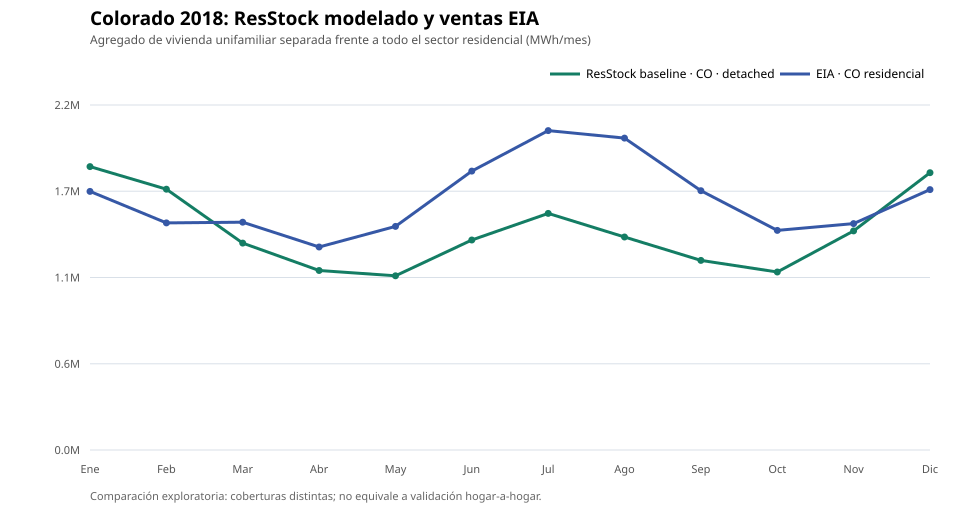

# Resultados de la primera muestra de datos

**Fecha de análisis:** 2026-11-16
**Estado:** muestra exploratoria validada; no es resultado representativo de todo el consumo residencial.
**Reproducibilidad:** `python -m pip install -r requirements.txt` y `python scripts/analizar_muestra_inicial.py --descargar`.

## Alcance y datos observados

- **ResStock:** `CO`, `Single-Family Detached`, escenario `0`; 35,040 intervalos y 96 columnas. Archivo de 31,004,915 bytes; SHA-256 `7f07296a7a94a1fd1606c2266959bd2f118eadf9d0b1891cf8a96c49cb9b0132`.
- **EIA:** Colorado, sector residencial, enero-diciembre de 2018; 12 registros mensuales con estado `Final`. Libro de 2,280,162 bytes; SHA-256 `c7963ad7c9bd2020cc7472f100a9c5330a4dff97a62be95407137a14b9c4044e`.
- **Open-Meteo:** temperatura horaria en un punto de Denver (39.7392, -104.9903), 2018 en UTC; 8,760 horas y 0 valores faltantes. Respuesta de 208,313 bytes; SHA-256 `ce5f9339e81b8785423fe5e158ba2557ee006cfdf62a349d835fa87f96e642b4`.

## Perfil ResStock y controles iniciales

- Los 35,040 timestamps son únicos y consecutivos, separados por 15.0 minutos; cubren `2018-01-01 00:15:00` a `2019-01-01 00:00:00`. El timestamp marca el final del intervalo, por lo que se restaron 15 minutos para asignar cada intervalo a su mes.
- No se encontraron celdas vacías (0) ni valores negativos en `out.electricity.total.energy_consumption..kwh` (0). El rango observado por intervalo fue 174,326.08–1,118,552.50 kWh agregados.
- El agregado indica 5,869 modelos y 1,490,160.655 unidades representadas. No equivale a 5,869 medidores reales: son resultados modelados y ponderados.

## Comparación mensual exploratoria con EIA

ResStock aquí cubre solo vivienda unifamiliar separada modelada; EIA cubre las ventas de todo el sector residencial estatal. Las unidades se expresaron en MWh para comparar escala y estacionalidad, no para afirmar igualdad de poblaciones.

| Mes | ResStock CO detached (MWh) | EIA CO residencial (MWh) | Razón exploratoria |
|---|---:|---:|---:|
| Ene | 1,812,597.23 | 1,653,911.40 | 109.59% |
| Feb | 1,667,852.33 | 1,452,241.20 | 114.85% |
| Mar | 1,322,864.87 | 1,456,725.50 | 90.81% |
| Abr | 1,147,907.04 | 1,297,995.10 | 88.44% |
| May | 1,114,155.94 | 1,429,900.70 | 77.92% |
| Jun | 1,343,082.37 | 1,783,312.10 | 75.31% |
| Jul | 1,512,931.30 | 2,042,863.00 | 74.06% |
| Ago | 1,362,359.35 | 1,994,351.80 | 68.31% |
| Sep | 1,212,696.57 | 1,658,108.00 | 73.14% |
| Oct | 1,138,391.12 | 1,404,371.80 | 81.06% |
| Nov | 1,401,276.70 | 1,448,118.50 | 96.77% |
| Dic | 1,773,538.48 | 1,665,052.90 | 106.52% |
| **Año** | **16,809,653.30** | **19,286,952.00** | **87.16%** |

Esta razón no es una métrica de precisión: compara una categoría residencial modelada con ventas de todo el sector, sin reconciliar cobertura, definiciones ni incertidumbre. El patrón sirve para plantear análisis posterior, no para afirmar validación o causalidad.

## Clima y alineación pendiente

La serie puntual de Denver tuvo temperatura entre -20.2 y 38.5 °C y media horaria de 10.26 °C. Es un producto de reanálisis, no una lectura de una estación. La consulta dejó el modelo en `Best Match` (valor predeterminado, combinación de modelos), no en un único modelo fijado. Se conserva como capa climática independiente: el punto no representa necesariamente todo Colorado y está en UTC, mientras ResStock publica timestamps en EST. No se hizo una unión ni correlación con el perfil estatal.

## Fuentes y atribución

- ResStock 2025.1 (OEDI): [archivo agregado](https://oedi-data-lake.s3.amazonaws.com/nrel-pds-building-stock/end-use-load-profiles-for-us-building-stock/2025/resstock_amy2018_release_1/timeseries_aggregates/by_state/upgrade=0/state=CO/up00-co-single-family_detached.csv), [FAQ oficial de ResStock](https://natlabrockies.github.io/ResStock.github.io/docs/FAQ.html), [registro OEDI](https://registry.opendata.aws/oedi-data-lake/). Atribuir a ResStock/NLR y DOE, y conservar la cita recomendada en el README del release. El registro general de OEDI declara CC BY 3.0 US; cualquier aviso específico del release prevalece.
- EIA: [archivo mensual oficial](https://www.eia.gov/electricity/data/eia861m/), [definición de datos EIA-861M](https://www.eia.gov/electricity/data/detail-data.php). Ventas residenciales en MWh; API no usada, no se solicitó clave.
- Clima: [Open-Meteo Historical Weather API](https://open-meteo.com/en/docs/historical-weather-api), [términos](https://open-meteo.com/en/terms). El API histórico usa reanálisis; la documentación señala que `Best Match` combina modelos. Atribución Open-Meteo pendiente de mantener en cualquier figura/publicación; uso académico no comercial asumido para esta prueba.

Los originales descargados quedan localmente bajo `data/raw/`, ignorados por Git; no se publicaron en este repositorio. El script obtiene únicamente estos tres objetos y genera esta tabla y el SVG.
